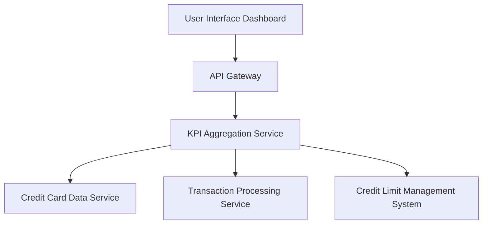

#### 1. High-Level Design

- **Summary:** This epic delivers a centralized dashboard that aggregates and displays key performance indicators for a user's credit card portfolio. The core requirement is to provide real-time visibility into monthly spend, total credit limit, available credit, and outstanding amounts through a responsive, consolidated interface that enables informed financial decision-making.

- **Component Flow:**

- **Integration Points:**
  - **Upstream:** Credit card data service (card information retrieval), Transaction processing service (monthly spend calculation), Credit limit management system (limit and available credit data)
  - **Downstream:** User interface layer (dashboard rendering)

- **Key Assumptions:** 
  - KPI data is refreshed in near real-time (assuming refresh interval of 5-15 minutes for non-transactional updates)
  - Outstanding amounts include both posted and pending transactions

- **NFR Highlights:** Dashboard load time < 2 seconds; real-time data refresh; responsive across desktop/tablet/mobile; 99.9% data accuracy

- **Data Flow:** User accesses the dashboard → API Gateway authenticates and routes request → KPI Aggregation Service queries Credit Card Data Service for card details, Transaction Processing Service for monthly spend, and Credit Limit Management System for limits and outstanding amounts → Aggregated KPIs are calculated and returned to UI → Dashboard renders consolidated view with monthly spend, total credit limit, available credit, and outstanding amounts.

#### 2. Validation Report

- **Requirements Coverage:** The design fully covers the epic's stated scope including monthly spend display, credit limit aggregation, available credit calculation, outstanding amount tracking, and consolidated dashboard view. All NFRs (2-second load time, real-time refresh, responsive design, 99.9% accuracy) are addressed through appropriate service architecture and integration points. Dependencies on credit card data service, transaction processing service, and credit limit management system are explicitly mapped in the component flow.