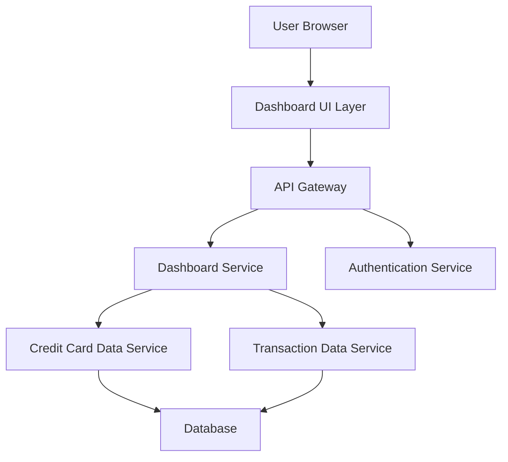

#### 1. High-Level Design

**Summary:**  
This epic delivers a consolidated dashboard that displays key performance indicators (KPIs) for all user credit cards, including monthly spend, total credit limit, available credit, and outstanding amounts. The dashboard provides a single, responsive interface for monitoring financial health and credit utilization across multiple cards on desktop, tablet, and mobile devices.

**Component Flow:**

**Integration Points:**
- **Upstream:** User Authentication Service (for secure access), Credit Card Data Source/Mock Data Service (for card information), Transaction Data Service (for spend calculations)
- **Downstream:** Dashboard UI consumes aggregated KPI data via API Gateway

**Key Assumptions:**
- Credit card data and transaction data are available via RESTful APIs with JSON format; KPI calculations (available credit, outstanding amounts) are performed server-side with data refreshed at regular intervals (assumed near real-time or polling-based).

**NFR Highlights:**  
Dashboard must load within 2 seconds for up to 10 credit cards; responsive design across desktop, tablet, and mobile; near real-time data refresh.

#### 2. Validation Report

**Requirements Coverage:**  
The design covers all stated scope elements: KPI display (monthly spend, total credit limit, available credit, outstanding amount), multiple credit card view, and responsive layout. The component flow includes necessary integrations with credit card data service, transaction service, and authentication service as specified in dependencies. NFRs for load time (2 seconds), responsive design, and data refresh are addressed through service-oriented architecture and appropriate UI layer design.