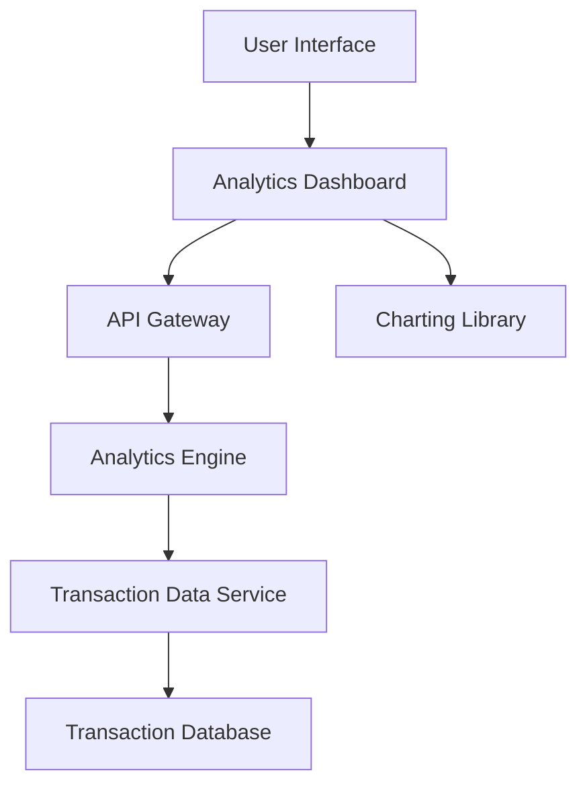

#### 1. High-Level Design

**Summary:**  
This epic provides interactive visualizations and analytics to help users understand spending patterns through category-wise analysis and monthly spend trends. Users can explore transaction data across 9 predefined categories (Food & Dining, Fuel, Shopping, Travel, Entertainment, Utilities, Healthcare, Education, Miscellaneous) to identify spending habits and make informed financial decisions.

**Component Flow:**

**Integration Points:**
- **Upstream:** Transaction Data Service (with categorized transaction records), Analytics Engine (for data aggregation and trend calculation)
- **Downstream:** Charting Library (for rendering interactive visualizations in the UI), Analytics Dashboard consumes aggregated spending data

**Key Assumptions:**
- Transactions are pre-categorized into the 9 defined categories by the transaction data service; monthly aggregation is computed server-side with results cached for performance optimization.

**NFR Highlights:**  
Analytics visualizations must render within 1.5 seconds for up to 1000 transactions; charts must be interactive with drill-down capabilities; efficient data aggregation for monthly and category-based views.

#### 2. Validation Report

**Requirements Coverage:**  
The design fully covers the epic scope: category-wise spending visualization, monthly spend trends analysis, interactive charts and graphs, transaction categorization across 9 predefined categories, spending pattern identification, and historical trend analysis. Required dependencies (transaction data service, analytics engine, charting library) are integrated into the component flow. NFRs for 1.5-second rendering time, interactivity with drill-down, and efficient aggregation are addressed through the analytics engine architecture and client-side charting library selection.