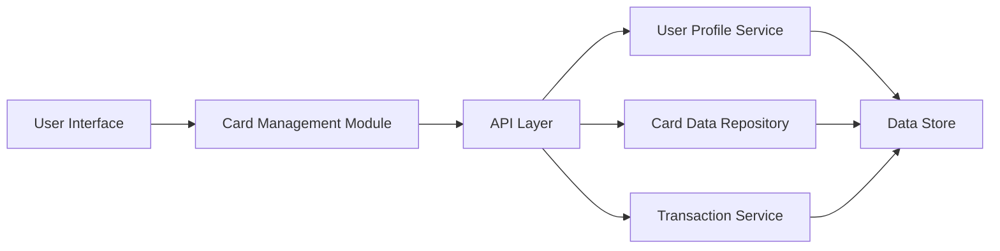

#### 1. High-Level Design

**Summary:**  
This epic enables users to manage and view multiple credit cards within a unified interface, providing card-wise spend analysis and the ability to switch between cards to view individual card details, limits, and usage patterns. The solution provides clear visual representation of each card's status and spending.

**Component Flow:**

**Integration Points:**
- **Upstream:** Credit Card Data Repository/Service (for card details and limits), User Profile Service (for card associations to user accounts), Transaction Service (for card-specific spending data)
- **Downstream:** Card Management UI module consumes card data and transaction data for visualization

**Key Assumptions:**
- Card data includes unique identifiers allowing card-specific filtering of transactions; card switching is handled via client-side state management with server-side data fetching optimized for sub-500ms response.

**NFR Highlights:**  
System must support minimum 10 credit cards per user; card switching and detail loading within 500ms; UI performance maintained with increasing card count.

#### 2. Validation Report

**Requirements Coverage:**  
The design addresses all scope items: multiple credit card display, card-wise spend analysis, individual card detail views, card selection/switching functionality, card status visualization, and credit limit per card display. The architecture incorporates required dependencies (card data repository, user profile service, transaction service). NFRs for supporting 10+ cards, 500ms switching performance, and scalable UI performance are addressed through efficient API design and optimized data retrieval patterns.