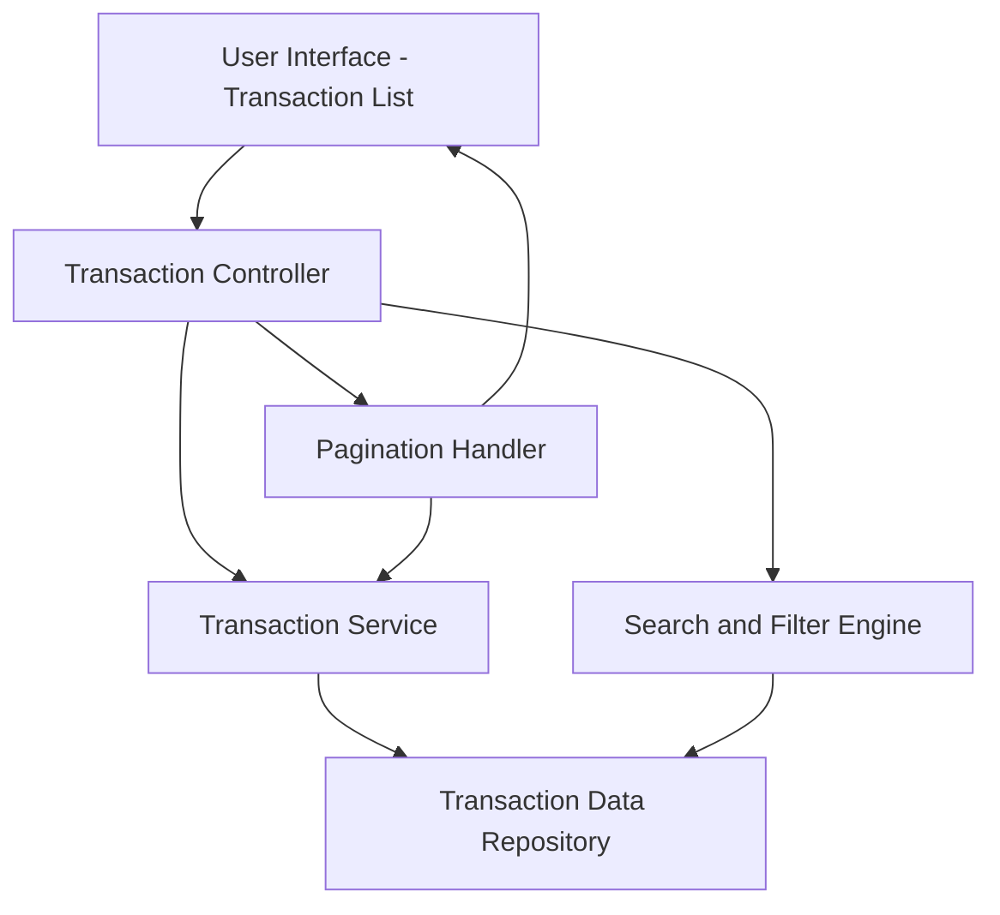

#### 1. High-Level Design

- **Summary:** This epic delivers comprehensive transaction visibility across all user credit cards through a centralized transaction management interface. Users can view complete transaction history, search for specific transactions, and apply filters to analyze spending behavior and track purchases. The system aggregates transactions from multiple cards into a single, unified view, providing transparency and control over all credit card activities.

- **Component Flow:**

- **Integration Points:** 
  - **Upstream:** Transaction data service or repository providing historical and current transaction records for all user credit cards
  - **Internal:** Search and filter engine for query processing
  - **Internal:** Pagination handler for efficient large dataset management

- **Key Assumptions:** 
  - Transactions are stored with standardized fields (date, amount, merchant, category, card ID) enabling consistent search and filter operations
  - Transaction data is indexed on key fields (date, card ID, merchant) to support sub-second search performance

- **NFR Highlights:** System must handle transaction data for multiple cards efficiently; transaction list must support pagination for large datasets; search and filter operations must complete within 1 second

- **Data Flow:** User accesses transaction list view → Transaction controller requests transaction data with pagination parameters (page number, page size) → Transaction service queries repository for user's transactions across all cards → Search/filter engine applies user-specified criteria (date range, card, merchant, amount range) → Filtered and paginated results are returned to controller → Transaction list is rendered in UI with pagination controls → User performs search/filter actions → Updated query is processed and results refreshed within 1 second → User navigates through pages to view complete transaction history.

#### 2. Validation Report

- **Requirements Coverage:** The design fully addresses the epic's scope including transaction listing, transaction history view, multi-card transaction aggregation, and transaction search and filter capabilities. All NFRs are covered: efficient handling of multi-card data through optimized repository queries, pagination support for large datasets via dedicated pagination handler, and sub-second search/filter performance through indexed queries and efficient search engine. The dependency on transaction data service/repository is explicitly incorporated in the architecture. Out-of-scope items (real bank integration, payments, fund transfers) are appropriately excluded from the design.