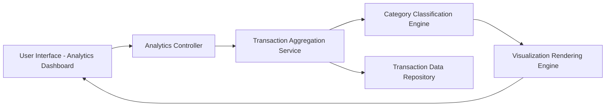

#### 1. High-Level Design

- **Summary:** This epic provides interactive data visualizations and analytical insights to help users understand spending patterns across their credit card portfolio. It includes monthly spend trend analysis over time, card-wise spending breakdowns, and category-wise spending analysis across nine predefined categories (Food & Dining, Fuel, Shopping, Travel, Entertainment, Utilities, Healthcare, Education, Miscellaneous). The analytics enable users to identify patterns, optimize card usage, and make data-driven financial decisions.

- **Component Flow:**

- **Integration Points:** 
  - **Upstream:** Transaction data aggregation service for calculating category totals, monthly trends, and card-wise breakdowns
  - **Upstream:** Charting library or visualization framework (e.g., Chart.js, D3.js, or similar) for rendering interactive graphs
  - **Internal:** Transaction data repository providing historical transaction records with category information

- **Key Assumptions:** 
  - Transactions are pre-categorized or auto-categorized into the nine predefined categories at the time of data ingestion
  - Monthly aggregations are computed on-demand or pre-calculated and cached for performance (assumed monthly batch processing or incremental updates)

- **NFR Highlights:** Charts and visualizations must be interactive and responsive; analytics calculations must process monthly data within 3 seconds; visualizations must render correctly across all device types and screen sizes

- **Data Flow:** User accesses analytics dashboard → Analytics controller requests spending data for selected time period and filters → Transaction aggregation service retrieves transaction records from repository → Category classification engine groups transactions by category, card, and month → Aggregated data (monthly totals, category breakdowns, card-wise spend) is passed to visualization rendering engine → Interactive charts (line charts for trends, bar/pie charts for category distribution) are generated and rendered in the UI → User interacts with visualizations (hover, filter, drill-down) for deeper insights.

#### 2. Validation Report

- **Requirements Coverage:** The design comprehensively covers all scope elements including monthly spend trends visualization, card-wise spend analysis, category-wise spending charts across nine categories, and interactive visualizations. The architecture supports spending pattern identification through the category classification and aggregation services. All NFRs are addressed: 3-second processing time through efficient aggregation, interactive and responsive charts via visualization framework, and cross-device rendering. Dependencies on transaction data aggregation and charting libraries are explicitly incorporated. The design excludes out-of-scope items (predictive analytics, budget recommendations) as specified.