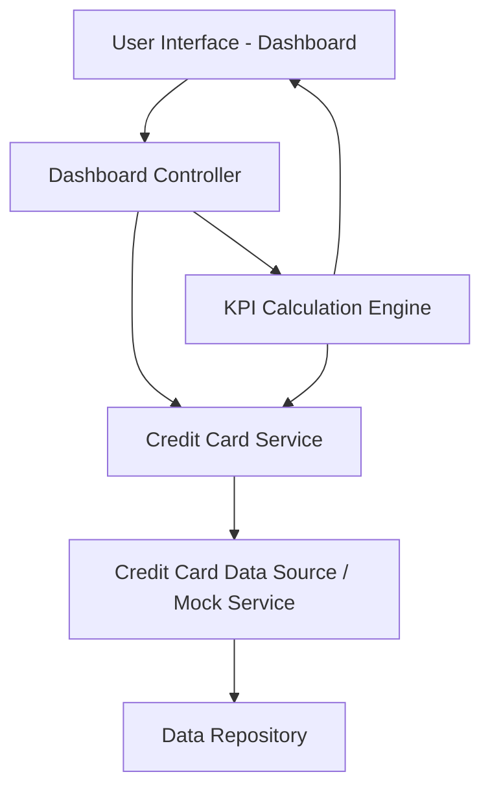

#### 1. High-Level Design

- **Summary:** This epic delivers a consolidated dashboard that aggregates all user credit cards in a single view, displaying critical KPIs including monthly spend, total credit limit, available credit, and outstanding amounts. The dashboard serves as the primary interface for users to monitor their overall credit card portfolio health and credit utilization in real-time without accessing multiple banking portals.

- **Component Flow:**

- **Integration Points:** 
  - **Upstream:** Credit card data source or mock data service providing card details, balances, credit limits, and outstanding amounts
  - **Downstream:** User interface components (web, tablet, mobile) consuming dashboard data via API endpoints

- **Key Assumptions:** 
  - Credit card data is refreshed at regular intervals (assumed near real-time or periodic sync, e.g., every 5-15 minutes) from the data source
  - Available credit is calculated as (Total Credit Limit - Outstanding Amount) using simple arithmetic without complex business rules

- **NFR Highlights:** Dashboard must load within 2 seconds; responsive layouts required across desktop, tablet, and mobile devices; real-time calculation of available credit and outstanding amounts

- **Data Flow:** User accesses the dashboard UI → Dashboard controller requests credit card portfolio data → Credit card service fetches card details from the data source/repository (card number, issuer, credit limit, outstanding balance) → KPI calculation engine computes monthly spend, available credit, and aggregated totals → Processed KPIs and card list are returned to the UI → Dashboard renders consolidated view with all cards and metrics displayed in a responsive layout.

#### 2. Validation Report

- **Requirements Coverage:** The design fully covers the epic's stated scope including dashboard KPIs display, monthly spend tracking, total credit limit display, available credit calculation, outstanding amount tracking, multiple credit cards view, and consolidated portfolio interface. All NFRs (2-second load time, responsive design, real-time calculations) are addressed through the component architecture. The integration dependency with credit card data source is explicitly incorporated in the design.