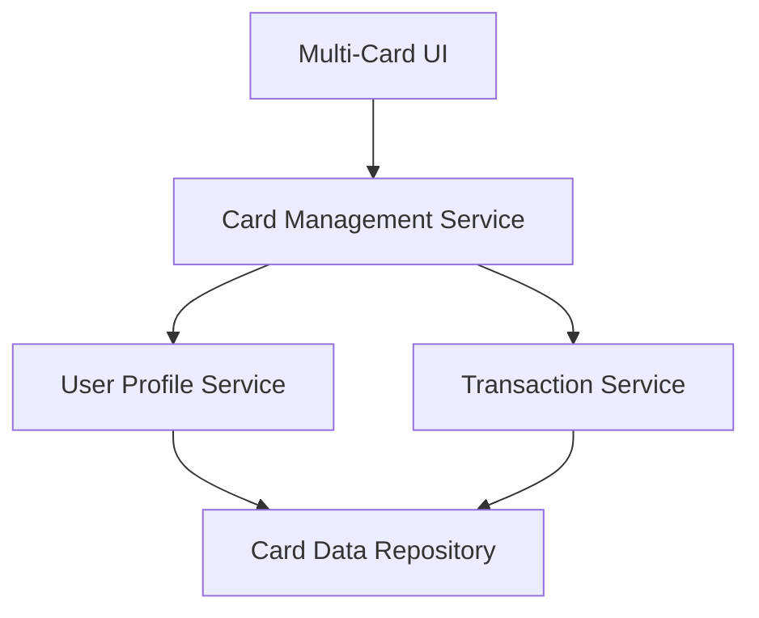

#### 1. High-Level Design

- **Summary:** This epic enables comprehensive multi-card management capabilities, allowing users to monitor and manage multiple credit cards from a unified interface. Users can view all their cards, access card-specific details, track individual spending patterns, and perform card-wise spend analysis. The system provides card-level insights to help users understand usage patterns across their entire credit card portfolio.

- **Component Flow:**

- **Integration Points:**
  - **Upstream:** User Profile Service (provides card ownership mapping and user-card associations)
  - **Upstream:** Transaction Service (provides card-specific transaction history and spending data)
  - Card Data Repository (stores card details and transaction records)

- **Key Assumptions:**
  - Card data is stored with user ownership mapping; card addition/removal is managed through User Profile Service.
  - Monthly spend trends are calculated based on transaction history aggregated by card and month.

- **NFR Highlights:** System must support minimum 10 credit cards per user; card data retrieval must complete within 1 second; interface must maintain performance with increasing number of cards; data must be securely stored and encrypted at rest.

- **Data Flow:** User accesses multi-card interface → Card Management Service retrieves user's card list from User Profile Service → For each card, service fetches card details and transaction history from Transaction Service → Card-specific spending patterns and trends are calculated → Multi-Card UI displays card listing with individual card details, monthly spend trends, and card-wise analysis. Key inputs include user ID, card identifiers, and transaction records; outputs include card listings, card-specific metrics, spending trends per card, and comparative analysis across cards.

#### 2. Validation Report

- **Requirements Coverage:** The design fully satisfies the epic's scope including multiple credit card display, card-wise spend analysis, individual card details view, card listing interface, card selection and filtering, and monthly spend trends per card. All NFRs are addressed: support for minimum 10 cards per user through scalable data model, 1-second card data retrieval through optimized service calls, performance maintenance with increasing cards through efficient caching and pagination strategies, and secure data storage with encryption at rest. Integration dependencies with User Profile Service and Transaction Service are properly incorporated. Out-of-scope items (real bank integration, card application process, card activation, card payments, loans) are correctly excluded from the design.