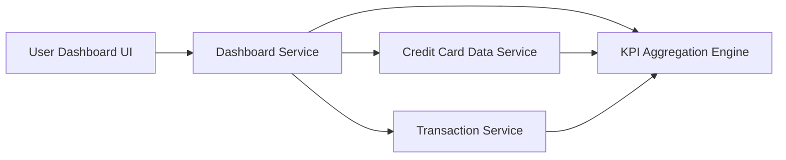

#### 1. High-Level Design

- **Summary:** This epic provides a centralized dashboard that displays key performance indicators for the user's credit card portfolio. The dashboard consolidates critical financial metrics including monthly spend, total credit limit, available credit, and outstanding amounts across all cards, providing real-time visibility into overall credit utilization and financial health to support informed decision-making.

- **Component Flow:**

- **Integration Points:**
  - **Upstream:** Credit Card Data Service (retrieves card balances and credit limits)
  - **Upstream:** Transaction Service (provides monthly spend calculations)
  - KPI Aggregation Engine (consolidates metrics across multiple cards)

- **Key Assumptions:**
  - Real-time data refresh refers to on-demand refresh triggered by user action or periodic polling (e.g., every 30-60 seconds), not sub-second streaming.
  - Credit utilization is calculated as (Outstanding Amount / Total Credit Limit) × 100.

- **NFR Highlights:** Dashboard must load within 2 seconds; system must support real-time data refresh; responsive design must support desktop, tablet, and mobile viewports; must handle concurrent users viewing dashboard simultaneously.

- **Data Flow:** User accesses dashboard → Dashboard Service requests card data from Credit Card Data Service (balances, limits) and monthly spend from Transaction Service → KPI Aggregation Engine calculates total credit limit, available credit, outstanding amounts, and credit utilization percentage → Aggregated KPIs are returned to Dashboard Service → Dashboard UI renders KPI widgets with consolidated metrics. Key inputs include individual card balances, limits, and transaction totals; outputs include aggregated financial health indicators displayed as visual KPI widgets.

#### 2. Validation Report

- **Requirements Coverage:** The design comprehensively addresses the epic's scope including monthly spend display, total credit limit aggregation, available credit calculation, outstanding amount tracking, responsive dashboard layout, and KPI visualization widgets. All NFRs are supported: 2-second load time through efficient service architecture, real-time data refresh capability via on-demand polling, responsive design for multiple viewports, and concurrent user support through scalable service layer. Integration dependencies with Credit Card Data Service and Transaction Service are properly incorporated. Out-of-scope items (real bank integration, payment processing, fund transfers, card payments, payment gateway integration) are correctly excluded from the design.