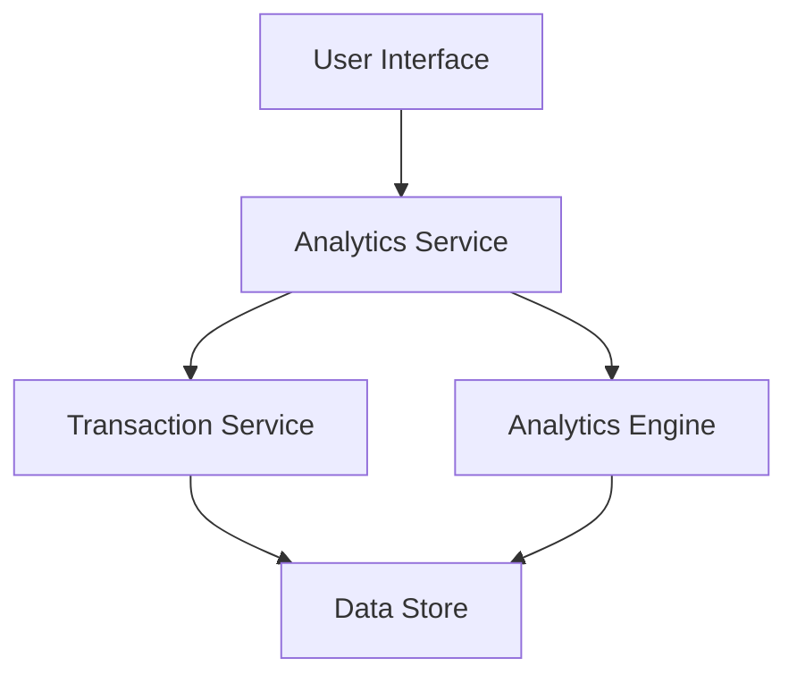

#### 1. High-Level Design

- **Summary:** This epic delivers an interactive analytics and visualization platform that enables users to analyze their credit card spending patterns across nine predefined categories (Food & Dining, Fuel, Shopping, Travel, Entertainment, Utilities, Healthcare, Education, Miscellaneous). The system provides visual representations including charts and trend analysis to help users understand spending behavior and make data-driven financial decisions.

- **Component Flow:**

- **Integration Points:**
  - **Upstream:** Transaction Service (provides transaction data and category mapping)
  - **Downstream:** Analytics Engine (performs data aggregation and trend calculation)
  - Data Store for historical transaction data (minimum 12 months)

- **Key Assumptions:**
  - Transaction data is pre-categorized by the Transaction Service; category mapping logic is maintained upstream.
  - Visualization refresh is user-initiated or scheduled at defined intervals (not continuous real-time streaming).

- **NFR Highlights:** Visualizations must render within 1.5 seconds; must support analysis of minimum 12 months of historical data; charts must be interactive and responsive; analytics engine must handle large transaction volumes efficiently.

- **Data Flow:** User selects date range and category filters via UI → Analytics Service retrieves transaction data from Transaction Service → Analytics Engine aggregates data by category and time period → Processed analytics data is returned to UI → Interactive visualizations (charts, trends) are rendered for user consumption. Key inputs include transaction records with categories, amounts, and timestamps; outputs include category-wise spending breakdowns, trend charts, and comparative analytics.

#### 2. Validation Report

- **Requirements Coverage:** The design fully covers the epic's stated scope including category-wise spending breakdown (all 9 categories), interactive visualizations, spending trend charts, and category filtering. The architecture supports the NFRs for rendering performance (1.5s), historical data analysis (12 months), interactivity, and scalability for large transaction volumes. Integration dependencies with Transaction Service and Analytics Engine are clearly addressed. Out-of-scope items (real bank integration, predictive analytics, budget creation, spending alerts, payment gateway, fund transfers) are explicitly excluded and not included in the design.