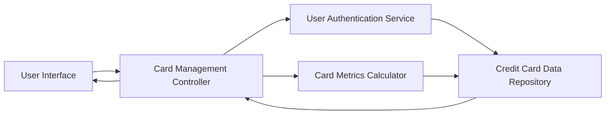

#### 1. High-Level Design

- **Summary:** This epic enables users to view and manage multiple credit cards within the dashboard, providing individual card details, card-specific metrics, and card-wise spend analysis. The core requirement is to deliver complete visibility into each card's performance, limits, and usage patterns to support portfolio-level credit management and optimization.

- **Component Flow:**

- **Integration Points:** 
  - **Upstream:** User authentication service for card ownership validation and security
  - **Upstream:** Credit card data repository or service for storing and retrieving card information
  - **Internal:** Card metrics calculator for computing card-specific analytics

- **Key Assumptions:** 
  - Card ownership is validated through authentication service before displaying card details
  - Card-wise spend analysis aggregates transactions by card identifier

- **NFR Highlights:** System must support display of at least 10 credit cards per user; card data refresh must occur within 3 seconds; card information must be securely stored and transmitted

#### 2. Validation Report

- **Requirements Coverage:** The design covers all scope elements including multiple credit card display, card-wise spend analysis, individual card details view, card selection and filtering, card-specific metrics tracking, and card comparison capabilities. The component flow integrates authentication, data retrieval, metrics calculation, and presentation layers. All NFRs (10-card minimum support, 3-second refresh time, secure storage and transmission) are explicitly addressed and must be validated through capacity testing and security audits.