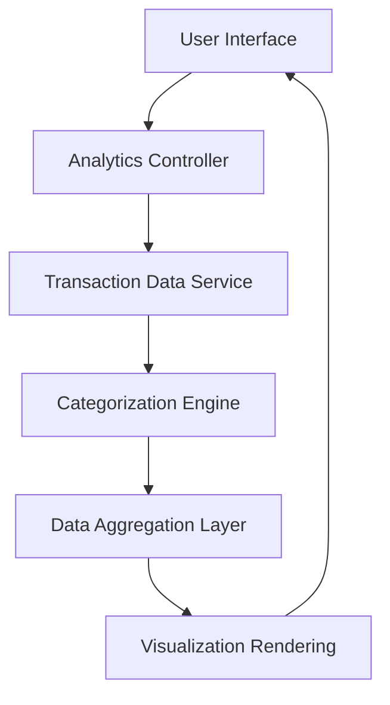

#### 1. High-Level Design

- **Summary:** This epic provides comprehensive spending analytics through interactive visualizations and transaction analysis. Users can explore spending patterns across nine predefined categories (Food & Dining, Fuel, Shopping, Travel, Entertainment, Utilities, Healthcare, Education, Miscellaneous), view monthly trends, and access transaction history to make data-driven financial decisions.

- **Component Flow:**

- **Integration Points:** 
  - **Upstream:** Transaction data service for retrieving historical transaction records (up to 12 months)
  - **Upstream:** Categorization engine or service for classifying transactions into nine spending categories
  - **External:** Charting library for interactive visualization rendering

- **Key Assumptions:** 
  - Transaction categorization is automated or pre-classified by the categorization engine
  - Monthly trend calculations aggregate data by calendar month boundaries

- **NFR Highlights:** Analytics visualizations must render within 1.5 seconds; must handle 12 months of transaction history; charts must support interactive drill-down; data aggregation accurate to 2 decimal places

#### 2. Validation Report

- **Requirements Coverage:** The design addresses all scope elements including category-wise visualization, monthly trend analysis, transaction history display, interactive charts, nine-category classification, pattern identification, and filtering/sorting capabilities. The component flow incorporates transaction retrieval, categorization, aggregation, and visualization layers. All NFRs (1.5-second render time, 12-month history support, interactive drill-down, 2-decimal accuracy) are explicitly covered and must be performance-tested during validation.