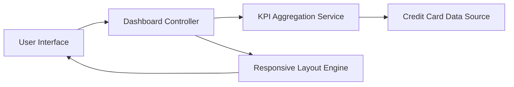

#### 1. High-Level Design

- **Summary:** This epic delivers a centralized dashboard that consolidates and displays key performance indicators (KPIs) for all user credit cards. The core requirement is to provide real-time visibility into monthly spend, total credit limit, available credit, and outstanding amounts across multiple cards through a responsive, device-agnostic interface.

- **Component Flow:**

- **Integration Points:** 
  - **Upstream:** Credit card data source or mock data service for retrieving card information and transaction data
  - **Downstream:** User interface layer for rendering dashboard components across devices

- **Key Assumptions:** 
  - Data refresh frequency is assumed to be near real-time or on-demand user refresh
  - KPI calculations (available credit, utilization) follow standard credit industry formulas

- **NFR Highlights:** Dashboard must load within 2 seconds; must support responsive design across mobile, tablet, and desktop devices; must comply with WCAG 2.1 accessibility standards

#### 2. Validation Report

- **Requirements Coverage:** The design covers all stated scope elements including KPI display, spend tracking, credit limit aggregation, available credit calculation, outstanding amount monitoring, responsive layout, and multi-card consolidated view. The component flow addresses data retrieval, aggregation, and presentation layers. All NFRs (2-second load time, responsive design, WCAG 2.1 compliance) are explicitly acknowledged and must be validated during implementation.