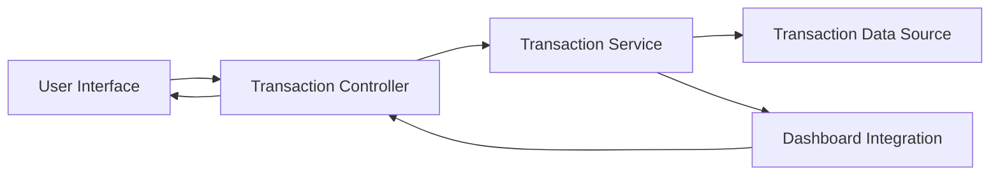

#### 1. High-Level Design

- **Summary:** This epic enables users to view and access detailed credit card transactions across all their cards. It provides transaction listing and detail views that integrate with dashboard KPIs and spending analytics, serving as the foundational data layer for expense tracking and verification.

- **Component Flow:**

- **Integration Points:** 
  - Transaction data source or service for retrieving card transaction history
  - Integrates with Dashboard KPIs for spend calculations
  - Feeds data to Spending Analytics and Insights epic

- **Key Assumptions:** 
  - Transaction data is retrieved via API with pagination support for large datasets
  - Transaction filtering and sorting are handled at the service layer for performance

- **NFR Highlights:** System must efficiently handle transaction data retrieval and display; Transaction list must support filtering and sorting without performance issues; Data must be presented in a user-friendly, responsive format

#### 2. Validation Report

- **Requirements Coverage:** The design addresses all core requirements including transaction listing, transaction details view, multi-card transaction support, and transaction data integration with dashboard KPIs. The architecture supports efficient data retrieval, filtering, and sorting as specified in NFRs, with clear integration points to dashboard and analytics components.