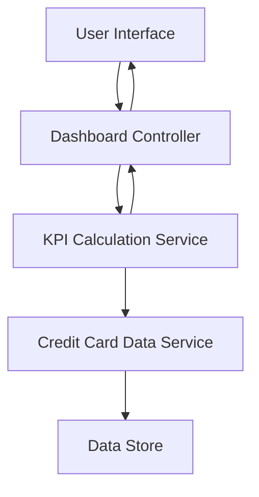

#### 1. High-Level Design

- **Summary:** This epic delivers a consolidated dashboard that displays all user credit cards with key performance indicators (monthly spend, total credit limit, available credit, outstanding amounts). It provides a single-pane view for monitoring credit card portfolio health across multiple cards with responsive design support.

- **Component Flow:**

- **Integration Points:** 
  - Credit card data source or mock data service for card details, balances, and limits
  - Integrates with transaction data to calculate monthly spend KPIs

- **Key Assumptions:** 
  - Card data is available via REST API or mock service with standard JSON format
  - KPI calculations are performed server-side and cached for performance

- **NFR Highlights:** Dashboard must be responsive across desktop, tablet, and mobile devices; Page load time must support real-time KPI calculations; UI must support multiple credit cards without performance degradation

#### 2. Validation Report

- **Requirements Coverage:** The design covers all stated requirements including dashboard KPIs display, multiple credit card view, monthly spend tracking, credit limit aggregation, available credit calculation, outstanding amount display, and responsive layout. The component flow supports real-time KPI calculations and multi-device responsiveness as specified in NFRs.