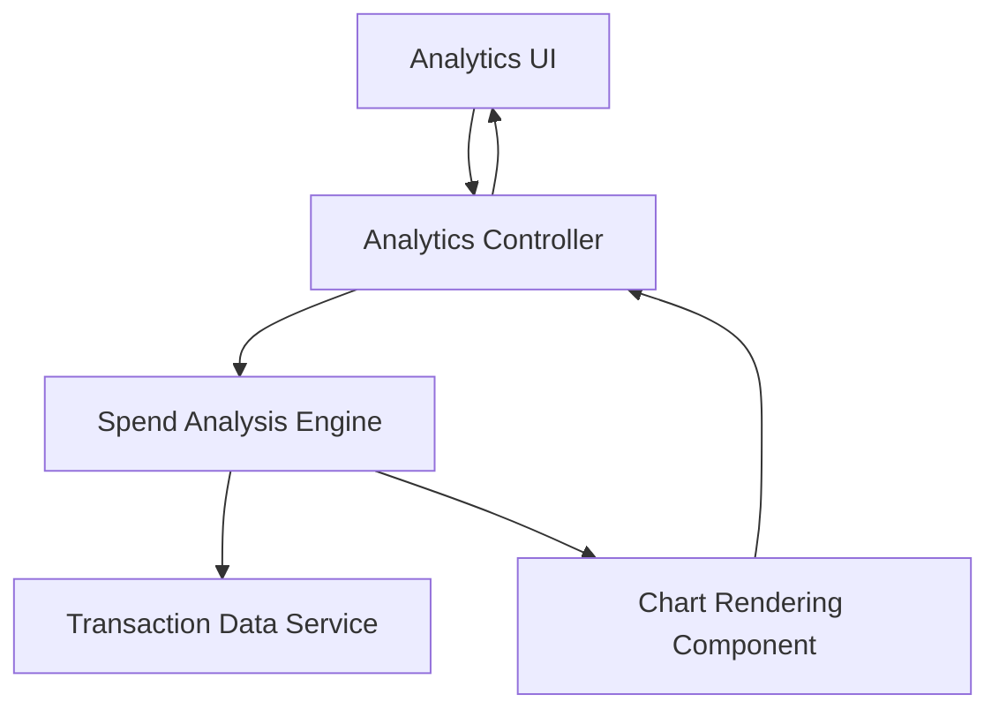

#### 1. High-Level Design

- **Summary:** This epic delivers interactive visualizations and analytical capabilities for spending pattern analysis. It includes monthly spend trends, card-wise spend breakdowns, and category-wise spending insights across nine predefined categories (Food & Dining, Fuel, Shopping, Travel, Entertainment, Utilities, Healthcare, Education, Miscellaneous), transforming transaction data into actionable insights.

- **Component Flow:**

- **Integration Points:** 
  - Depends on transaction data and card data for analytics calculations
  - Integrates with Dashboard KPIs for consistent spend metrics
  - Consumes data from Transaction Management epic

- **Key Assumptions:** 
  - Transaction categorization is pre-assigned or mapped to one of nine categories via business rules
  - Analytics calculations are optimized with aggregation at the data layer for large datasets

- **NFR Highlights:** Visualizations must be interactive and responsive; Analytics must support real-time or near-real-time data updates; Charts must render efficiently even with large transaction datasets; UI must maintain performance across all device types

#### 2. Validation Report

- **Requirements Coverage:** The design comprehensively covers all stated requirements including monthly spend trends visualization, card-wise spend analysis, category-wise spending breakdown across nine categories, interactive charts and graphs, and spending pattern identification. The architecture supports real-time data updates, efficient chart rendering, and responsive performance across devices as mandated by NFRs.