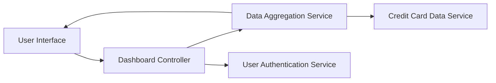

#### 1. High-Level Design

- **Summary:** This epic delivers a consolidated dashboard providing users with a unified view of their entire credit card portfolio and key performance indicators (KPIs). Users can monitor monthly spend, total credit limits, available credit, and outstanding balances across all cards in real-time, enabling informed financial decisions and credit utilization management.

- **Component Flow:**

- **Integration Points:**
  - **Upstream:** User Authentication Service (for secure user access and session management)
  - **Upstream:** Credit Card Data Service (for retrieving card information, balances, and transaction data)
  - **Internal:** Data Aggregation Service (for calculating consolidated metrics across multiple cards)

- **Key Assumptions:** 
  - Credit card data is retrieved via REST API calls with JSON payload format.
  - KPI calculations (available credit, outstanding amounts) are performed server-side with cached results refreshed every 30 seconds.

- **NFR Highlights:** Dashboard must load within 2 seconds; supports real-time KPI updates; responsive design for desktop and mobile; 99.9% data accuracy.

#### 2. Validation Report

- **Requirements Coverage:** The design fully addresses the epic's scope including dashboard KPI display, monthly spend tracking, credit limit aggregation, available credit calculation, outstanding amount tracking, multiple credit card view, consolidated portfolio overview, and responsive layout. All stated NFRs (2-second load time, real-time updates, responsive design, 99.9% accuracy) are accounted for in the architecture through dedicated aggregation services and caching strategies.