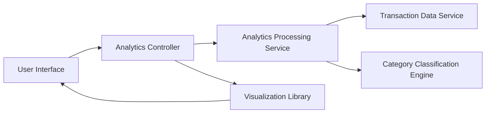

#### 1. High-Level Design

- **Summary:** This epic delivers advanced analytics and visualization capabilities that transform raw transaction data into actionable spending insights. Users can explore interactive visualizations showing spending patterns across nine categories (Food & Dining, Fuel, Shopping, Travel, Entertainment, Utilities, Healthcare, Education, Miscellaneous) and analyze monthly spend trends over time to support data-driven financial decisions.

- **Component Flow:**

- **Integration Points:**
  - **Upstream:** Transaction Data Service (for retrieving historical transaction records)
  - **Internal:** Category Classification Engine (for automatic transaction categorization into 9 predefined categories)
  - **Internal:** Analytics Processing Service (for trend calculations, aggregations, and pattern identification)
  - **Frontend:** Visualization Library (for rendering interactive charts and graphs)

- **Key Assumptions:** 
  - Transactions are auto-categorized using rule-based or ML classification engine with manual override capability.
  - Historical data is retained for minimum 12 months to support meaningful trend analysis.

- **NFR Highlights:** Analytics visualizations must render within 1.5 seconds; process up to 10,000 transactions per user; interactive and responsive charts across all device sizes; 100% accuracy in data aggregation calculations.

#### 2. Validation Report

- **Requirements Coverage:** The design fully addresses all scope requirements including category-wise spending visualization, monthly spend trend analysis, interactive charts and graphs, nine spending category tracking, transaction data aggregation, spending pattern identification, historical trend comparison, and visual analytics dashboard. All NFRs are supported through optimized analytics processing (1.5-second render time), scalable transaction processing (10,000 transactions), responsive visualization library, and accurate aggregation algorithms (100% calculation accuracy).