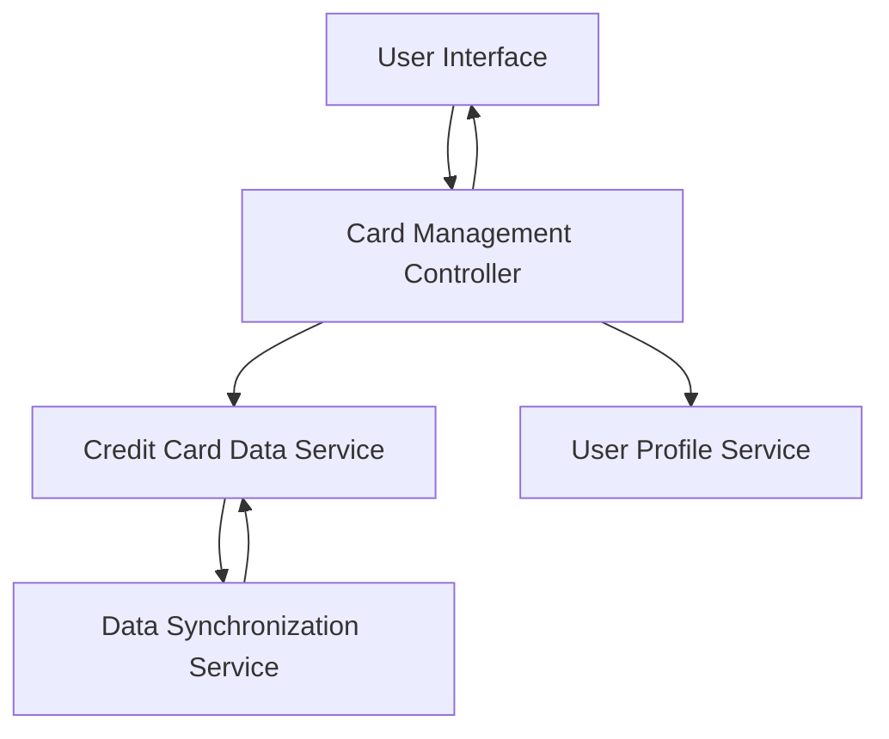

#### 1. High-Level Design

- **Summary:** This epic enables comprehensive management and monitoring of multiple credit cards within the application. Users can view detailed card-specific information including balances, credit limits, utilization rates, and card-wise spend analysis. The feature provides organized interfaces for adding, viewing, and managing up to 20 credit cards, serving as the foundation for multi-card financial management.

- **Component Flow:**

- **Integration Points:**
  - **Upstream:** Credit Card Data Service (for retrieving card details, balances, and transaction history)
  - **Upstream:** User Profile Service (for validating card ownership and user permissions)
  - **Internal:** Data Synchronization Service (for keeping card information up-to-date across the system)

- **Key Assumptions:** 
  - Card data synchronization occurs via polling mechanism every 3 seconds or through webhook notifications.
  - Card utilization metrics are calculated as percentage of credit limit used, updated in near real-time.

- **NFR Highlights:** System must support minimum 10 credit cards per user; card data refresh within 3 seconds; maintain performance with up to 20 cards displayed simultaneously.

#### 2. Validation Report

- **Requirements Coverage:** The design comprehensively covers all scope items including multiple credit card display, card-wise spend analysis, individual card details view, card-specific credit limit tracking, card-specific balance monitoring, card organization interface, and card utilization metrics. The architecture supports all NFRs through scalable data services capable of handling 10-20 cards per user with 3-second refresh cycles and optimized rendering performance.