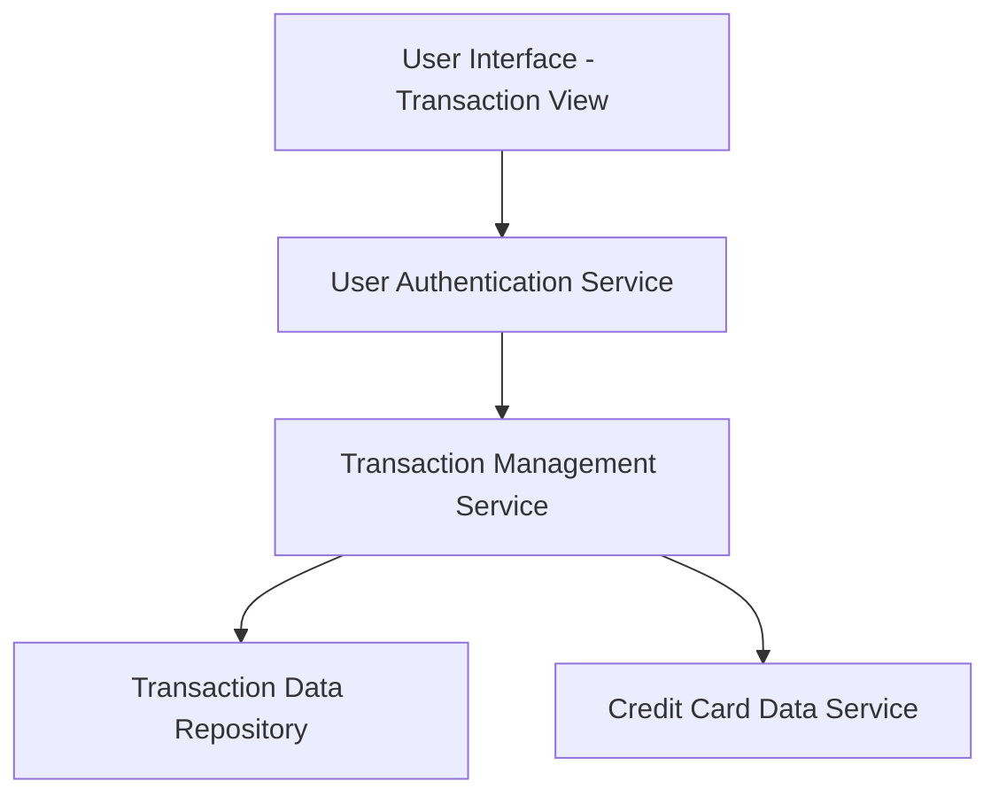

#### 1. High-Level Design

- **Summary:** This epic provides users with the ability to view and monitor credit card transactions across all their cards. Users can access detailed transaction information to track spending activities, review purchase history, and maintain visibility into all card usage. The transaction management capability is essential for users to understand where their money is being spent and to verify card activity.

- **Component Flow:**

- **Integration Points:**
  - **Upstream:** Transaction data repository or service for retrieving transaction records
  - **Upstream:** Credit card data source for linking transactions to specific cards
  - **Upstream:** User authentication service for secure transaction access
  - **Downstream:** Responsive UI framework for displaying transaction lists and details

- **Key Assumptions:**
  - Transactions are stored with card identifiers allowing filtering by card; transaction history is available for a minimum of 12 months.
  - Transaction details include standard fields: date, merchant name, amount, category, card used, and transaction status.

- **NFR Highlights:** System must efficiently handle and display large volumes of transaction data; transaction data must be displayed with minimal latency; interface must remain responsive when loading transaction histories across multiple cards.

- **Data Flow:** User authenticates and accesses transaction view → User Interface sends request to Transaction Management Service with user ID and optional filters (date range, card selection) → Service validates user authorization via User Authentication Service → Service retrieves user's card list from Credit Card Data Service → Service queries Transaction Data Repository for transactions associated with user's cards → Transactions are sorted, paginated, and returned to UI → Responsive interface displays transaction list with details (date, merchant, amount, category, card) with options to filter and drill down into individual transaction details.

#### 2. Validation Report

- **Requirements Coverage:** The design fully addresses all scope items including transaction viewing, multi-card transaction display, transaction history access, transaction detail display, and responsive transaction interface. The architecture supports the NFRs for efficient handling of large transaction volumes through pagination and optimized queries, minimal latency through direct repository access, and responsive interface design across devices. All identified dependencies (transaction data repository, credit card data source, user authentication service) are properly integrated into the component flow. The design explicitly excludes out-of-scope items (transaction editing/deletion, real bank integration, payments) while providing comprehensive read-only transaction visibility across all user credit cards.