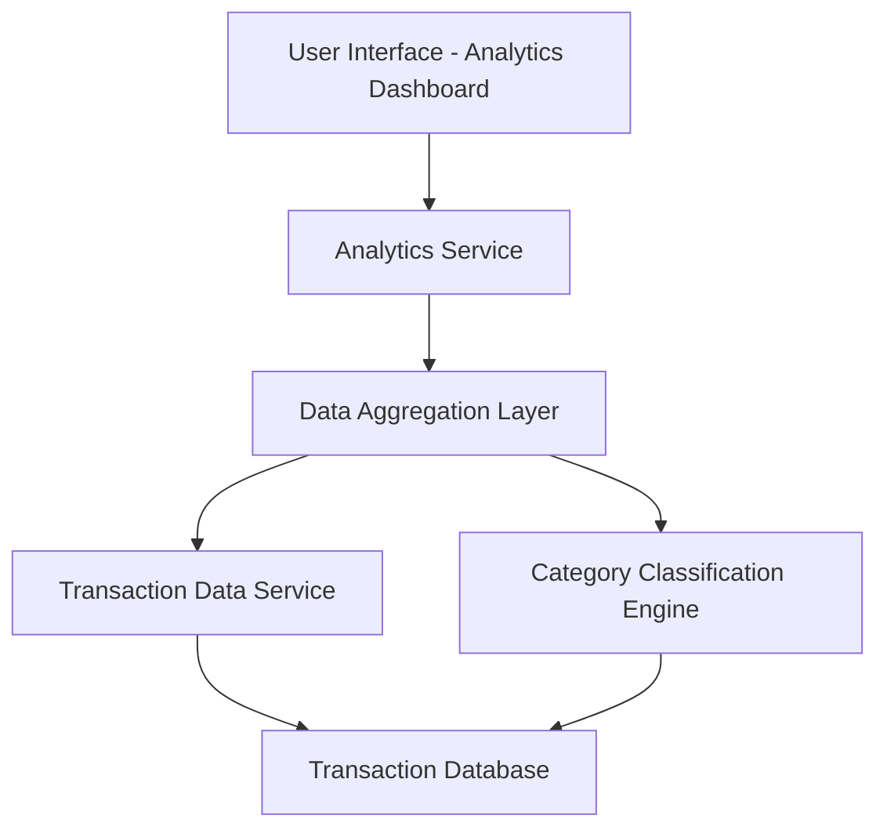

#### 1. High-Level Design

- **Summary:** This epic delivers interactive visualizations and analytical capabilities that enable users to understand their spending patterns through category-wise analysis and monthly spend trends. Users can explore spending across 9 predefined categories (Food & Dining, Fuel, Shopping, Travel, Entertainment, Utilities, Healthcare, Education, Miscellaneous) with card-wise spend analysis to compare spending across different credit cards and identify monthly spending trends over time.

- **Component Flow:**

- **Integration Points:**
  - **Upstream:** Transaction data service for aggregating spending information
  - **Upstream:** Category classification service or logic for categorizing transactions
  - **Upstream:** Card data service for card-wise analysis
  - **Upstream:** Date/time service for monthly trend calculations
  - **Downstream:** Interactive visualization library/framework for rendering charts and graphs

- **Key Assumptions:**
  - Transactions are pre-categorized or a rule-based classification engine exists to assign categories automatically; category mappings are maintained centrally.
  - Monthly trend analysis covers a rolling 12-month period by default unless otherwise specified by user filters.

- **NFR Highlights:** Visualizations must render efficiently with responsive design; analytics calculations must process spending data across multiple cards and time periods without performance issues; charts must be interactive and support user exploration.

- **Data Flow:** User requests spending analytics from the UI → Analytics Service retrieves transaction data via Transaction Data Service → Data Aggregation Layer aggregates transactions by category, card, and time period using Category Classification Engine → Processed analytics data (category totals, monthly trends, card-wise breakdowns) is returned to Analytics Service → Interactive charts and visualizations are rendered on the user interface with drill-down capabilities.

#### 2. Validation Report

- **Requirements Coverage:** The design fully covers the epic's stated scope including category-wise spending visualization across 9 categories, monthly spend trend analysis, card-wise spend analysis, interactive charts and graphs, and spending pattern identification. The component architecture supports all required analytical capabilities with proper separation of concerns between data aggregation, classification, and visualization layers. The design addresses the NFRs for responsive rendering, efficient processing across multiple cards and time periods, and interactive user exploration. All identified dependencies (transaction data service, category classification, card data service, date/time service) are incorporated into the architecture.