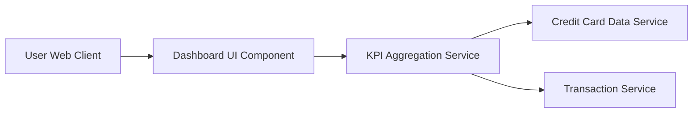

#### 1. High-Level Design

- **Summary:** This epic delivers a consolidated dashboard that displays key performance indicators (KPIs) for the user's credit card portfolio, including monthly spend, total credit limit, available credit, and outstanding amounts. The dashboard provides at-a-glance visibility into overall credit card health through a modern, responsive interface.

- **Component Flow:**

- **Integration Points:**
  - **Upstream:** Credit Card Data Service (for retrieving card details and balances)
  - **Upstream:** Transaction Service (for calculating monthly spend metrics)

- **Key Assumptions:**
  - KPI data refresh occurs at regular intervals (assumed near real-time polling or event-driven updates). Data aggregation logic resides in a dedicated service layer accessible by the dashboard UI.

- **NFR Highlights:** Dashboard must load within 2 seconds; must support responsive design across desktop, tablet, and mobile devices; UI must refresh KPI data in real-time or near real-time.

#### 2. Validation Report

- **Requirements Coverage:** The design covers all stated scope items including dashboard KPI display, monthly spend calculation, total credit limit aggregation, available credit computation, outstanding amount tracking, and responsive layout design. The component flow ensures integration with required upstream services (Credit Card Data Service and Transaction Service) to fulfill KPI calculations and data retrieval. The NFRs for load time (2 seconds), responsive design, and real-time data refresh are addressed through the architecture's separation of concerns and dedicated aggregation service.