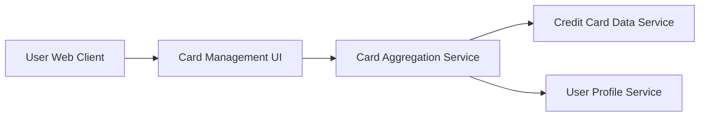

#### 1. High-Level Design

- **Summary:** This epic enables users to view and manage multiple credit cards within a single unified interface. Users can see a consolidated view of all their credit cards with individual card details, limits, and balances, and can switch between cards, compare performance, and navigate seamlessly across their credit portfolio.

- **Component Flow:**

- **Integration Points:**
  - **Upstream:** Credit Card Data Service (for fetching multiple card information)
  - **Upstream:** User Profile Service (to associate cards with specific users)

- **Key Assumptions:**
  - Card data is fetched on-demand or cached with periodic refresh. User-card associations are maintained in the User Profile Service and queried during session initialization.

- **NFR Highlights:** System must support management of at least 10 credit cards per user; card switching and selection must respond within 500ms; interface must adapt to various screen sizes maintaining usability.

#### 2. Validation Report

- **Requirements Coverage:** The design addresses all scope elements including multiple credit card display, card-wise spend analysis, individual card details view, card comparison functionality, card selection and filtering, and responsive card layout. The component flow integrates with Credit Card Data Service and User Profile Service as specified in dependencies. The NFRs for supporting at least 10 cards per user, 500ms response time for card switching, and responsive interface are achievable through the proposed service-oriented architecture with efficient data retrieval and caching strategies.