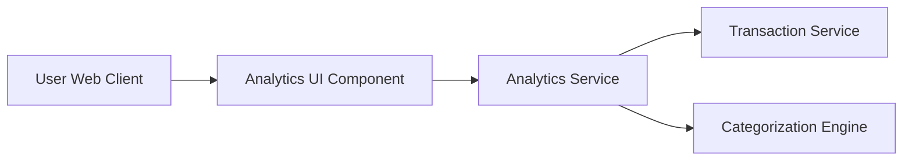

#### 1. High-Level Design

- **Summary:** This epic provides interactive visualizations and analytics capabilities that help users understand their spending patterns through category-wise analysis and monthly spend trends. Users can explore transactions across 9 predefined categories (Food & Dining, Fuel, Shopping, Travel, Entertainment, Utilities, Healthcare, Education, Miscellaneous) with interactive drill-down capabilities and multi-category comparison.

- **Component Flow:**

- **Integration Points:**
  - **Upstream:** Transaction Service (for retrieving transaction data)
  - **Upstream:** Categorization Engine (for automatic transaction categorization)
  - **Upstream:** Analytics Service (for trend computation and visualization rendering)

- **Key Assumptions:**
  - Transactions are pre-categorized by the Categorization Engine before being consumed by the Analytics Service. Visualization rendering uses client-side charting libraries with data aggregated server-side.

- **NFR Highlights:** Analytics visualizations must render within 3 seconds; system must handle and categorize transactions across 9 predefined categories; charts must be interactive and support user interactions with sub-second response time.

#### 2. Validation Report

- **Requirements Coverage:** The design comprehensively covers all scope items including category-wise spending visualization, monthly spend trend analysis, interactive charts and graphs, transaction categorization, spending pattern identification, category filtering and drill-down, and multi-category comparison. The architecture integrates with all specified dependencies: Transaction Service, Categorization Engine, and Analytics Service. The NFRs for 3-second visualization rendering, support for 9 categories, and sub-second interactive response are addressed through the separation of data processing (server-side) and visualization rendering (client-side with optimized charting libraries).