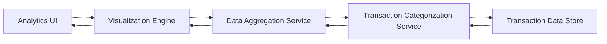

#### 1. High-Level Design

- **Summary:** This epic provides interactive visualizations and analytics capabilities to help users understand spending behavior through category-wise breakdowns and monthly spend trends. Users can analyze spending across 9 predefined categories (Food & Dining, Fuel, Shopping, Travel, Entertainment, Utilities, Healthcare, Education, Miscellaneous) with actionable insights for data-driven financial decisions.

- **Component Flow:**

- **Integration Points:**
  - **Upstream:** Transaction categorization service or engine for assigning categories to transactions
  - **Downstream:** Data aggregation service for computing trend analysis and category summaries
  - **External:** Charting library or visualization framework (e.g., Chart.js, D3.js) for rendering interactive charts

- **Key Assumptions:**
  - Transactions will be auto-categorized using predefined rules or ML models; manual recategorization is out of scope
  - Historical data will be retained for 12 months with monthly aggregation for trend analysis

- **NFR Highlights:** Analytics visualizations must render within 1.5 seconds; handle 12 months of historical data; interactive charts with drill-down; responsive across all device types

- **Data Flow:** User accesses analytics dashboard → Analytics UI requests aggregated spending data → Data Aggregation Service queries Transaction Categorization Service → Categorization Service retrieves and categorizes transactions from Transaction Data Store → Aggregated data by category and time period returned to Aggregation Service → Visualization Engine receives structured data and renders interactive charts (category breakdown, monthly trends) → User interacts with visualizations (drill-down, filter by category/time) → Updated data fetched and charts re-rendered dynamically

#### 2. Validation Report

- **Requirements Coverage:** The design fully addresses the epic's scope including category-wise spending visualization, monthly spend trends analysis, interactive charts and graphs, spending pattern identification, and multi-category support for all 9 predefined categories. All NFRs are satisfied through optimized rendering (1.5 seconds), efficient data aggregation for 12-month history, interactive charting framework with drill-down capabilities, and responsive design patterns. The architecture supports scalability and maintainability while providing actionable insights to users.