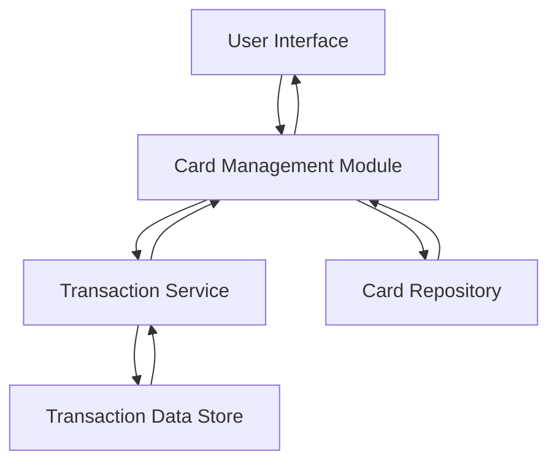

#### 1. High-Level Design

- **Summary:** This epic enables users to view and manage multiple credit cards from a unified interface, providing card-wise spending analysis, transaction viewing, and card detail management. The system consolidates information from multiple cards to enable comparison and portfolio-level insights.

- **Component Flow:**

- **Integration Points:**
  - **Upstream:** Credit card data repository or service for card details and metadata
  - **Downstream:** Transaction data feed or mock transaction service for retrieving transaction history
  - **Internal:** Card Management Module orchestrates card and transaction data aggregation

- **Key Assumptions:**
  - Each credit card will have a unique identifier for data retrieval and management
  - Transaction data will be paginated with default page size of 50 transactions per request to meet performance requirements

- **NFR Highlights:** System must support at least 10 credit cards per user; card data retrieval within 3 seconds; transaction history paginated with support for 1000+ transactions per card

- **Data Flow:** User selects card management view → Card Management Module retrieves all cards associated with user from Card Repository → User selects specific card for details → Transaction Service fetches paginated transaction data from Transaction Data Store → Card-wise spending analysis computed from transaction data → Aggregated card details and transactions displayed to user with comparison capabilities across cards

#### 2. Validation Report

- **Requirements Coverage:** The design comprehensively covers all scope elements including multiple credit card display, card-wise spend analysis, transaction viewing, card details management, and card comparison capabilities. NFRs are addressed through pagination strategy (supporting 1000+ transactions), optimized data retrieval patterns (3-second SLA), and scalable architecture supporting 10+ cards per user. The modular design allows for future extensibility while maintaining performance constraints.