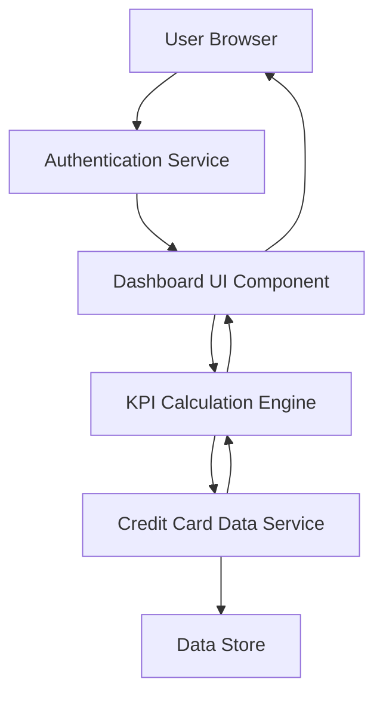

#### 1. High-Level Design

- **Summary:** This epic delivers a centralized dashboard that displays critical financial KPIs including monthly spend, total credit limit, available credit, and outstanding amounts. The dashboard provides a consolidated, responsive view across devices to help users quickly understand their overall credit card financial position.

- **Component Flow:**

- **Integration Points:** 
  - **Upstream:** User authentication service for personalized dashboard access
  - **Downstream:** Credit card data source or mock data service for retrieving card and transaction data
  - **Internal:** KPI calculation engine for aggregating and computing financial metrics

- **Key Assumptions:** 
  - Data will be provided in a structured JSON format from the credit card data service
  - KPI calculations will be performed server-side with configurable refresh intervals (default: real-time or every 5 minutes)

- **NFR Highlights:** Dashboard must load within 2 seconds; responsive design across mobile, tablet, and desktop; near real-time or configurable data refresh rate

- **Data Flow:** User authenticates and requests dashboard → Authentication service validates user → Dashboard UI requests KPI data → KPI Calculation Engine retrieves raw credit card data from Data Service → Engine aggregates data (monthly spend, total limit, available credit, outstanding) → Computed KPIs returned to Dashboard UI → Dashboard renders visualizations and displays to user

#### 2. Validation Report

- **Requirements Coverage:** The design fully covers the epic's stated scope including monthly spend display, total credit limit calculation, available credit tracking, outstanding amount monitoring, responsive dashboard layout, and KPI visualization. All NFRs regarding load time (2 seconds), responsive design, and configurable data refresh are addressed through appropriate architectural components (caching, responsive UI framework, and configurable refresh engine).