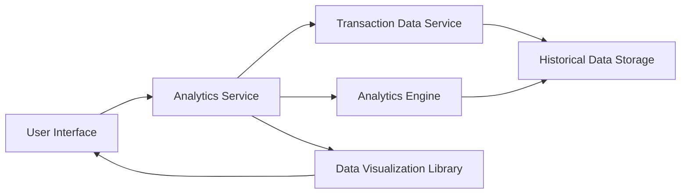

#### 1. High-Level Design

- **Summary:** This epic delivers comprehensive spending analysis capabilities enabling users to track and analyze credit card expenditure over time. Users can view monthly spend trends to understand spending patterns and access card-wise spend breakdowns to identify which credit cards are used most frequently, enabling optimization of credit card usage based on historical data and card-specific benefits.

- **Component Flow:**

- **Integration Points:**
  - **Upstream:** Transaction data service (provides transaction records for analysis), Historical data storage system (stores at least 12 months of transaction history)
  - **Downstream:** Analytics engine (performs trend analysis, aggregations, and comparative calculations), Data visualization library (renders interactive charts for trends and breakdowns)
  - **Internal:** Analytics Service orchestrates data retrieval, analysis, and visualization

- **Key Assumptions:**
  - Historical data for at least 12 months is available in the historical data storage system; data retention policy ensures sufficient history for trend analysis.
  - Card-wise breakdown assumes each transaction is tagged with the specific credit card used; card identification is provided by the transaction data service.

- **NFR Highlights:** Analytics queries must execute within 3 seconds; system must handle historical data for at least 12 months; charts and visualizations must be interactive and responsive; data visualization must support multiple device screen sizes.

- **Data Flow:** User requests spending trends/analysis → Analytics Service receives request with filters (time period, card selection) → Transaction Data Service retrieves relevant transactions from Historical Data Storage → Analytics Engine processes data to calculate monthly trends and card-wise breakdowns → Aggregated results passed to Data Visualization Library → Interactive charts and visualizations rendered on User Interface with responsive design for multiple devices. Time-based filtering is applied at the query level to optimize performance.

#### 2. Validation Report

- **Requirements Coverage:** The design fully addresses all scope elements including monthly spend trend visualization, card-wise spending breakdown, historical spending data display, comparative spending analysis across cards, and time-based filtering. All NFRs are satisfied: 3-second query execution through optimized analytics engine, 12-month historical data support via dedicated storage system, interactive and responsive charts through data visualization library, and multi-device support through responsive design. All dependencies (transaction data service, analytics engine, data visualization library, historical data storage) are integrated into the architecture and data flow.