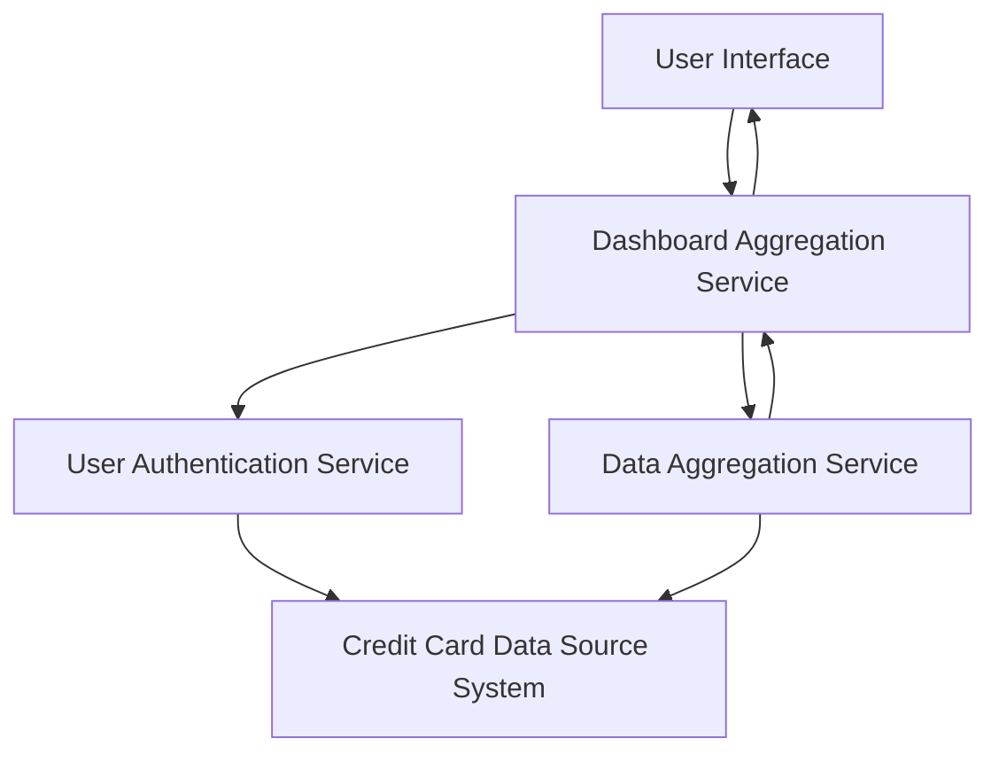

#### 1. High-Level Design

- **Summary:** This epic provides a consolidated dashboard displaying key performance indicators for the user's credit card portfolio, including monthly spend, total credit limit, available credit, and outstanding amounts across all credit cards. The dashboard serves as a single interface for users to monitor their overall credit card financial health and make informed spending decisions.

- **Component Flow:**

- **Integration Points:**
  - **Upstream:** Credit card data source system (provides credit card account details, balances, limits, transactions), User authentication service (validates user identity and authorizes access to credit card data)
  - **Downstream:** Data aggregation service (consolidates data from multiple credit cards and calculates KPIs)
  - **Internal:** Dashboard Aggregation Service coordinates data retrieval and KPI calculation

- **Key Assumptions:**
  - Credit card data is retrieved from a centralized data source system that aggregates information from multiple card issuers; direct bank API integration is out of scope.
  - Real-time data refresh means data is updated at regular intervals (e.g., every few minutes) rather than streaming updates.

- **NFR Highlights:** Dashboard must load within 2 seconds; system must support real-time data refresh; responsive design for mobile and desktop devices; data accuracy must be 100% for financial calculations.

- **Data Flow:** User accesses dashboard → User Authentication Service validates identity → Dashboard Aggregation Service requests credit card data → Credit Card Data Source System provides account details, balances, limits → Data Aggregation Service calculates KPIs (monthly spend, total credit limit, available credit, outstanding amounts) → Aggregated KPIs returned to Dashboard Aggregation Service → Results rendered on User Interface with responsive design for multiple devices.

#### 2. Validation Report

- **Requirements Coverage:** The design comprehensively covers all stated scope elements including dashboard KPIs display, monthly spend tracking, total credit limit aggregation, available credit calculation, outstanding amount tracking, multiple credit card view, and consolidated portfolio interface. All NFRs are addressed: 2-second load time through efficient data aggregation, real-time refresh capability, responsive design for mobile/desktop, and 100% accuracy through validated financial calculations. All dependencies (credit card data source, user authentication, data aggregation service) are integrated into the architecture.