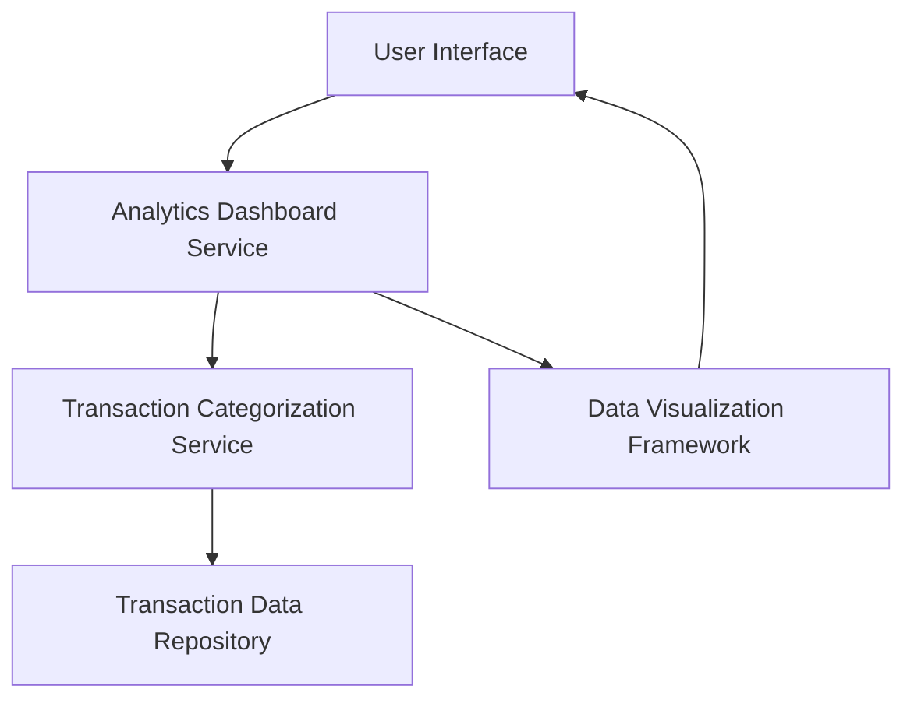

#### 1. High-Level Design

- **Summary:** This epic delivers category-wise spending analytics enabling users to visualize and analyze their credit card transactions across nine predefined categories (Food & Dining, Fuel, Shopping, Travel, Entertainment, Utilities, Healthcare, Education, Miscellaneous). Users can view transaction history, filter/search transactions, and gain insights into spending patterns by category to improve budget management.

- **Component Flow:**

- **Integration Points:**
  - **Upstream:** Transaction categorization service (provides categorized transaction data), Transaction data repository (source of raw transaction records)
  - **Downstream:** Data visualization framework (renders interactive charts and graphs)
  - **External:** Category mapping engine (maps transactions to predefined categories)

- **Key Assumptions:**
  - Transaction categorization is performed automatically by the categorization service using predefined rules or ML models; manual recategorization by users is not in scope.
  - Transaction data is refreshed daily or near real-time; exact refresh frequency not specified.

- **NFR Highlights:** Category calculations must be 100% accurate; interactive visualizations must render within 2 seconds; system must support filtering/sorting large transaction datasets; mobile-responsive visualizations required.

- **Data Flow:** User requests category analytics → Analytics Dashboard Service fetches transactions from Transaction Data Repository → Transaction Categorization Service applies category mapping → Categorized data is aggregated by category → Data Visualization Framework renders interactive charts → Results displayed to user. Transaction filtering/search requests follow similar flow with query parameters passed to repository layer.

#### 2. Validation Report

- **Requirements Coverage:** The design fully covers the epic's stated scope including category-wise visualization, transaction list view, interactive charts, nine predefined categories, filtering/search, and visual analytics dashboard. All NFRs (accuracy, performance, scalability, mobile responsiveness) are addressed through appropriate component selection and architecture patterns. Integration points with transaction categorization service, data visualization framework, transaction data repository, and category mapping engine are clearly identified and incorporated into the component flow.