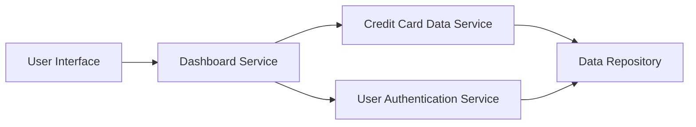

#### 1. High-Level Design

- **Summary:** This epic delivers a consolidated dashboard that displays key performance indicators (KPIs) for the user's credit card portfolio, including monthly spend, total credit limit, available credit, and outstanding amounts. The dashboard provides a single, responsive interface for users to monitor their overall credit card financial health and make informed spending decisions.

- **Component Flow:**

- **Integration Points:**
  - **Upstream:** User Authentication Service (for secure user access and session management)
  - **Downstream:** Credit Card Data Service (for retrieving card details, balances, credit limits, and outstanding amounts)

- **Key Assumptions:** 
  - KPI data is refreshed in near real-time or at regular intervals (e.g., every few minutes) to ensure accuracy.
  - Credit card data format follows a standardized schema provided by the Credit Card Data Service API.

- **NFR Highlights:** Dashboard must be responsive across all device types (mobile, tablet, desktop); page load time should support real-time data refresh; system must handle multiple credit cards per user without performance degradation.

#### 2. Validation Report

- **Requirements Coverage:** The design adequately covers the epic's stated scope by incorporating all required KPIs (monthly spend, total credit limit, available credit, outstanding amounts) and ensuring multi-card consolidated view through integration with the Credit Card Data Service. The responsive dashboard layout addresses the NFR requirements for cross-device compatibility and performance.