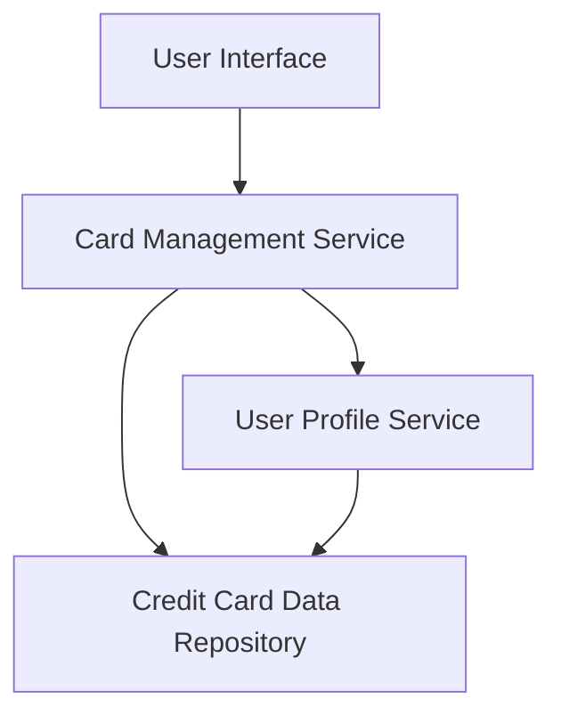

#### 1. High-Level Design

- **Summary:** This epic enables users to manage and view multiple credit cards within a single dashboard interface. Users can see all registered cards, access individual card details, switch between cards, and obtain a comprehensive portfolio overview. This consolidates credit card management into one unified experience.

- **Component Flow:**

- **Integration Points:**
  - **Upstream:** User Profile Service (for associating credit cards with user accounts and managing user-card relationships)
  - **Downstream:** Credit Card Data Repository (for storing and retrieving card information, card details, and portfolio data)

- **Key Assumptions:** 
  - Card data is pre-populated in the repository; no real-time bank integration is required for this epic.
  - The system supports a reasonable upper limit of cards per user (e.g., up to 20-30 cards) without significant UI/UX degradation.

- **NFR Highlights:** System must support viewing and managing multiple credit cards per user; interface must maintain responsiveness when displaying large numbers of cards; card data must be securely stored and transmitted.

#### 2. Validation Report

- **Requirements Coverage:** The design fully addresses the epic's scope by providing mechanisms for displaying multiple cards, card-wise information views, card selection/switching, and portfolio overview. Integration with the User Profile Service and Credit Card Data Repository ensures proper data association and retrieval. Security and responsiveness NFRs are acknowledged in the design approach.