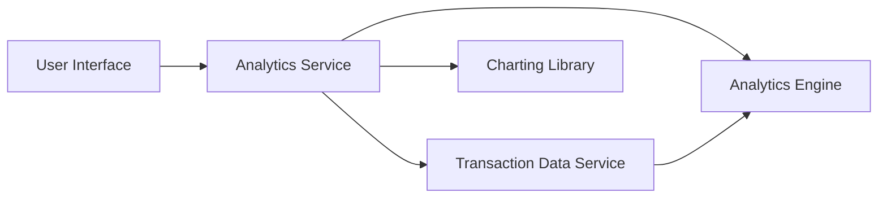

#### 1. High-Level Design

- **Summary:** This epic provides users with interactive visualizations and analytics to understand spending patterns across nine predefined categories (Food & Dining, Fuel, Shopping, Travel, Entertainment, Utilities, Healthcare, Education, Miscellaneous). It includes monthly spend trends, card-wise spend breakdown, and interactive charts to support data-driven financial decisions.

- **Component Flow:**

- **Integration Points:**
  - **Upstream:** Transaction Data Service (for retrieving historical spending and transaction data)
  - **Downstream:** Analytics Engine (for processing, categorizing, and aggregating transaction data); Charting Library (for rendering interactive visualizations in the UI)

- **Key Assumptions:** 
  - Transactions are pre-categorized by the Transaction Data Service or Analytics Engine into the nine predefined categories.
  - Analytics processing occurs server-side to minimize client-side performance impact for large datasets.

- **NFR Highlights:** Visualizations must load within acceptable time frames even with large transaction datasets; analytics must support interactive filtering and drill-down capabilities; charts must be responsive and render correctly on all device types.

#### 2. Validation Report

- **Requirements Coverage:** The design comprehensively covers the epic's requirements by incorporating category-wise spending visualization, monthly trends analysis, card-wise spend breakdown, and interactive charts. Integration with the Transaction Data Service and Analytics Engine ensures proper data retrieval and processing. The use of a dedicated Charting Library addresses the visualization and responsiveness requirements specified in the NFRs.