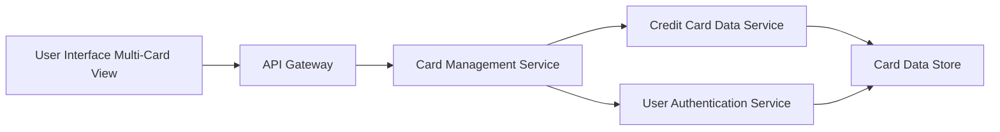

#### 1. High-Level Design

- **Summary:** This epic enables users to view and manage multiple credit cards within a unified interface, providing individual card details, card-wise spend analysis, monthly spend trends per card, and comparison capabilities. Users can track up to 10+ credit cards simultaneously to optimize card usage and financial planning.

- **Component Flow:**

- **Integration Points:**
  - **Upstream:** Credit card data service (retrieves card information and balances), User authentication service (validates card ownership and user permissions)
  - **Downstream:** UI components for card display, spend analysis charts, and comparison views

- **Key Assumptions:**
  - Card ownership is validated via user authentication service; each user has a unique identifier linking them to their registered cards.
  - Card-wise spend analysis aggregates transaction data by card ID; monthly trends are calculated server-side and cached for performance.

- **NFR Highlights:** System must support minimum 10 credit cards per user; card data retrieval must complete within 1 second; concurrent user support for multi-card operations.

#### 2. Validation Report

- **Requirements Coverage:** The design fully covers the stated scope: multiple credit card display, card-wise spend analysis, monthly spend trends per card, individual card detail views, and card comparison capabilities. Integration with credit card data service and user authentication service ensures secure and efficient data retrieval. NFRs for supporting 10+ cards per user, 1-second retrieval time, and concurrent operations are addressed through optimized queries, caching, and scalable service architecture.