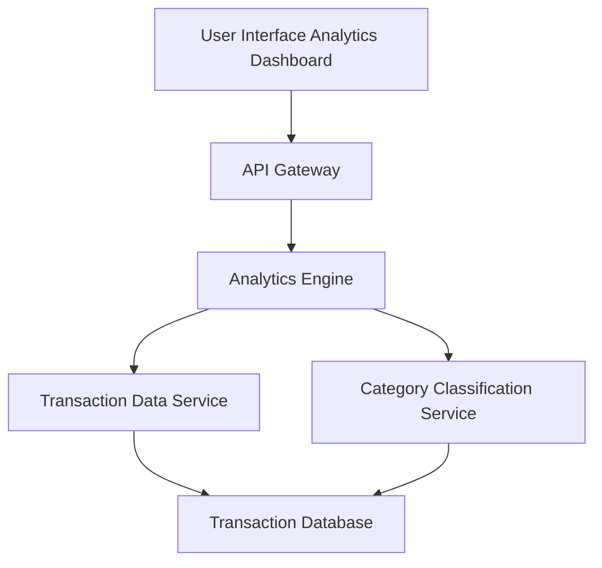

#### 1. High-Level Design

- **Summary:** This epic provides interactive visualizations and analytics for transaction data, enabling users to understand spending patterns through category-wise breakdowns across nine predefined categories (Food & Dining, Fuel, Shopping, Travel, Entertainment, Utilities, Healthcare, Education, Miscellaneous). Users can filter, sort, and analyze transaction history to identify trends and optimize spending.

- **Component Flow:**

- **Integration Points:**
  - **Upstream:** Transaction data service (retrieves transaction records), Category classification service (categorizes transactions into predefined categories), Analytics engine (aggregates and processes data for visualization)
  - **Downstream:** Interactive charting library in UI layer for rendering visualizations

- **Key Assumptions:**
  - Transactions are pre-categorized by the category classification service; manual re-categorization is not in scope for this epic.
  - Analytics engine performs aggregation queries optimized for up to 10,000 transactions with indexed category and date fields.

- **NFR Highlights:** Analytics visualizations must render within 3 seconds; support filtering and sorting of up to 10,000 transactions; interactive charts must be responsive across all device sizes.

#### 2. Validation Report

- **Requirements Coverage:** The design addresses all scope elements: category-wise spending visualization, transaction listing and filtering, interactive charts and graphs, spending pattern analysis, nine predefined categories, and transaction history view. Integration with transaction data service, category classification service, and analytics engine ensures comprehensive data flow. NFRs for rendering performance (3 seconds), transaction volume support (10,000 transactions), and responsive charts are explicitly accommodated through the analytics engine and optimized data retrieval architecture.