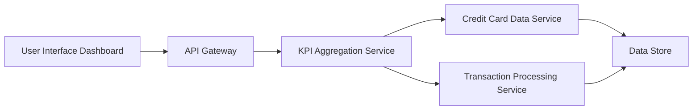

#### 1. High-Level Design

- **Summary:** This epic delivers a consolidated dashboard that aggregates credit card portfolio data and displays key performance indicators (KPIs) including monthly spending, total credit limits, available credit, and outstanding amounts. The dashboard provides real-time visibility into financial health through a responsive, modern interface.

- **Component Flow:**

- **Integration Points:**
  - **Upstream:** Credit card data service (retrieves card balances and limits), Transaction processing service (calculates monthly spend)
  - **Downstream:** User interface layer consuming aggregated KPI data via API

- **Key Assumptions:**
  - KPI calculations are performed server-side and cached for performance; data refresh occurs at configurable intervals (assumed real-time means < 5 seconds staleness).
  - Credit card data service provides standardized JSON responses with balance, limit, and outstanding amount fields.

- **NFR Highlights:** Dashboard must load within 2 seconds; support responsive design for mobile and desktop; real-time data refresh for KPI metrics.

#### 2. Validation Report

- **Requirements Coverage:** The design covers all stated scope items: monthly spend KPI, total credit limit KPI, available credit KPI, outstanding amount KPI, consolidated dashboard view, and responsive layout. The component flow addresses integration with required services (credit card data and transaction processing). NFRs for load time (2 seconds), responsive design, and real-time refresh are explicitly supported through the architecture with API gateway, aggregation service, and caching strategy.