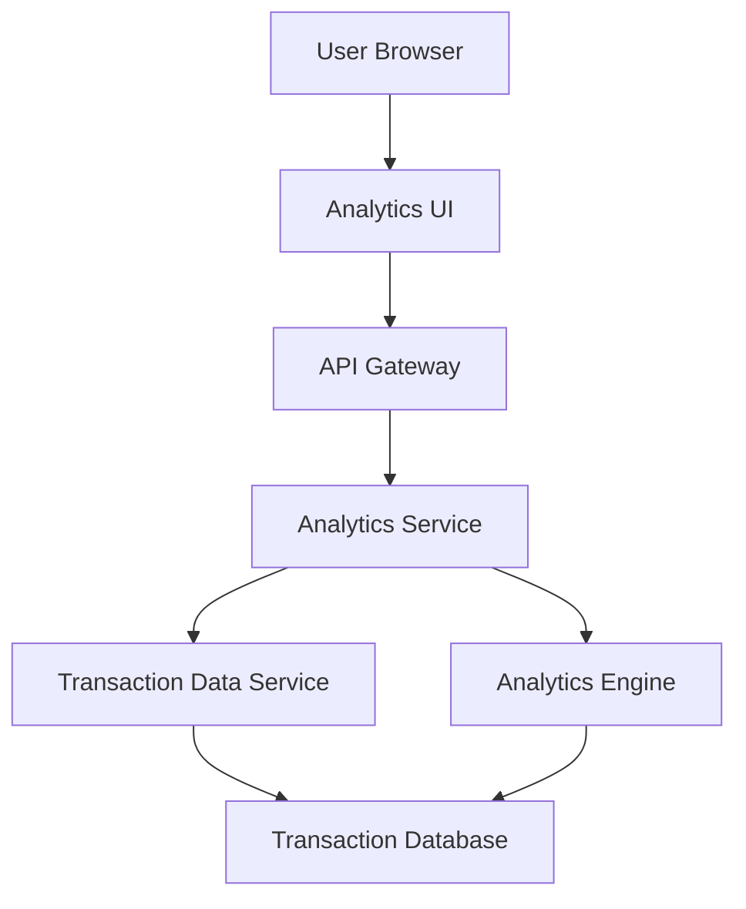

#### 1. High-Level Design

- **Summary:** This epic delivers interactive analytics and visualization capabilities enabling users to understand spending behavior through category-wise breakdowns and monthly trends. Users can explore spending patterns across nine predefined categories (Food & Dining, Fuel, Shopping, Travel, Entertainment, Utilities, Healthcare, Education, Miscellaneous) with actionable insights through visual representations.

- **Component Flow:**

- **Integration Points:** 
  - **Upstream:** Transaction data service (for retrieving categorized transactions), Analytics engine (for processing and aggregating spending data)
  - **Downstream:** User browser/client applications with interactive charting libraries

- **Key Assumptions:** 
  - Transactions are pre-categorized into the nine defined categories at ingestion time.
  - Analytics engine maintains rolling 12-month aggregations to meet 3-second rendering requirement for visualizations.

- **NFR Highlights:** Analytics visualizations must render within 3 seconds; System must handle transaction history of up to 12 months; Charts must be interactive and support drill-down capabilities.

- **Data Flow:** User requests spending analytics → API Gateway routes to Analytics Service → Service queries Transaction Data Service for categorized transactions (filtered by date range, up to 12 months) → Analytics Engine processes and aggregates data by category and time period → Aggregated data returned to Analytics UI → UI renders interactive charts and graphs showing category-wise spending breakdown, monthly trends, and drill-down capabilities for detailed transaction exploration.

#### 2. Validation Report

- **Requirements Coverage:** The design fully addresses all scope requirements including category-wise spending visualization, monthly spend trend analysis, interactive charts and graphs, spending breakdown by all nine specified categories, and transaction categorization. All NFRs are met: 3-second rendering through pre-aggregated data, 12-month transaction history support via database design, and interactive drill-down capabilities through UI framework selection. Integration dependencies with Transaction Data Service and Analytics Engine are properly mapped. The architecture supports the analytical workload and user interaction patterns described in the epic.