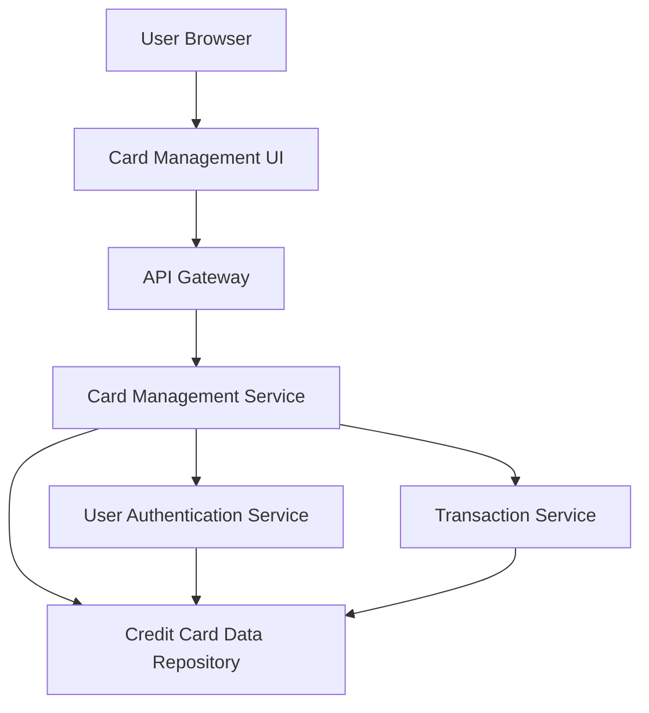

#### 1. High-Level Design

- **Summary:** This epic enables users to view, track, and manage multiple credit cards (up to 50 per user) within a single consolidated interface. Users can see all their credit cards with individual card details, perform card-wise spend analysis, and monitor spending patterns across different cards to optimize credit card usage strategy.

- **Component Flow:**

- **Integration Points:** 
  - **Upstream:** User authentication service (for card ownership verification), Credit card data repository (for storing and retrieving card information), Transaction service (for card-wise spend analysis)
  - **Downstream:** User browser/client applications

- **Key Assumptions:** 
  - Card data is indexed by user ID for fast retrieval to meet 1-second per card requirement.
  - Transaction data is pre-aggregated per card for monthly spend trends to avoid real-time computation delays.

- **NFR Highlights:** System must support viewing and managing up to 50 credit cards per user; Card data retrieval must complete within 1 second per card.

- **Data Flow:** User accesses card management interface → API Gateway authenticates user via User Authentication Service → Card Management Service retrieves user's card list from Credit Card Data Repository → For selected card, service fetches card details and queries Transaction Service for card-wise spend analysis → Monthly spend trends and card performance metrics calculated → Data returned to UI for display with card selection and filtering capabilities.

#### 2. Validation Report

- **Requirements Coverage:** The design comprehensively covers all scope items including multiple credit card display, card-wise spend analysis, individual card details view, card selection and filtering, and monthly spend trends per card. NFRs for supporting up to 50 cards and 1-second retrieval time are addressed through indexed data access and pre-aggregated transaction data. Dependencies on User Authentication Service and Credit Card Data Repository are properly integrated. The architecture supports scalability and performance requirements.