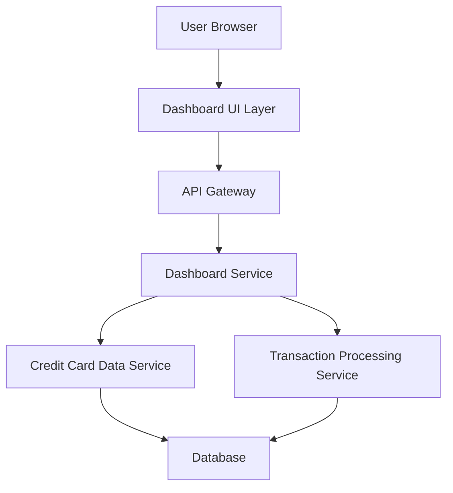

#### 1. High-Level Design

- **Summary:** This epic delivers a consolidated, responsive dashboard providing real-time visibility into credit card financial health through key performance indicators (KPIs). Users can view monthly spend, total credit limit, available credit, and outstanding amounts across all credit cards from a single interface, enabling quick assessment of their overall credit card portfolio status.

- **Component Flow:**

- **Integration Points:** 
  - **Upstream:** Credit card data service (for retrieving card balances and limits), Transaction processing service (for calculating monthly spend and outstanding amounts)
  - **Downstream:** User browser/client applications (web, tablet, mobile)

- **Key Assumptions:** 
  - Data is pre-aggregated or cached to meet the 2-second load time requirement.
  - Credit card data and transaction data are stored in a centralized database accessible by both upstream services.

- **NFR Highlights:** Dashboard must load within 2 seconds; System must support responsive design across desktop, tablet, and mobile devices; Real-time data refresh capability.

- **Data Flow:** User requests dashboard → API Gateway routes to Dashboard Service → Dashboard Service queries Credit Card Data Service for card balances/limits and Transaction Processing Service for monthly spend/outstanding amounts → Services retrieve data from Database → Aggregated KPI data returned to Dashboard UI → UI renders KPIs (monthly spend, total credit limit, available credit, outstanding amount) in responsive layout.

#### 2. Validation Report

- **Requirements Coverage:** The design fully covers the epic's stated scope including monthly spend display, total credit limit aggregation, available credit calculation, outstanding amount tracking, responsive dashboard layout, and KPI visualization. All NFRs (2-second load time, responsive design, real-time refresh) are addressed through architectural decisions including data caching, API Gateway for routing, and responsive UI layer. Integration dependencies with Credit Card Data Service and Transaction Processing Service are clearly mapped.