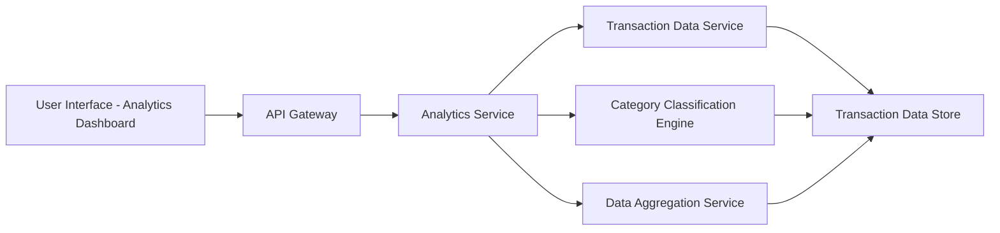

#### 1. High-Level Design

- **Summary:** This epic provides interactive analytics and visualization capabilities that enable users to understand their spending patterns and financial behavior. Users can view monthly spend trends over time and analyze spending by categories (Food & Dining, Fuel, Shopping, Travel, Entertainment, Utilities, Healthcare, Education, Miscellaneous) through visual representations such as charts and graphs.

- **Component Flow:**

- **Integration Points:** 
  - **Upstream:** Transaction data service (for spending history), Category classification engine (for transaction categorization), Data aggregation service (for trend calculations)
  - **Downstream:** Analytics UI for rendering interactive charts and visualizations

- **Key Assumptions:** 
  - Transactions are pre-classified into categories by the classification engine
  - Historical data is retained for at least 12 months for trend analysis

- **NFR Highlights:** Analytics must support minimum 12 months of historical data; visualization rendering time under 1 second; interactive charts responsive across all device types

- **Data Flow:** User requests analytics view → API Gateway routes to Analytics Service → Service retrieves transaction history from Transaction Data Service → Category Classification Engine categorizes transactions into 9 predefined categories → Data Aggregation Service calculates monthly trends and category breakdowns → Aggregated data returned to UI → Interactive charts and graphs rendered with sub-1-second performance showing spending patterns, trends, and comparisons

#### 2. Validation Report

- **Requirements Coverage:** The design fully addresses all scope elements including monthly spend trend visualization, category-wise spending analysis (across all 9 categories), interactive charts and graphs, spending pattern identification, multi-category breakdown, historical spending comparison, and card-wise spend analysis. All NFRs (12 months historical data, sub-1-second rendering, responsive charts) are incorporated. Integration dependencies with transaction data service, category classification engine, and data aggregation service are fully covered. Out-of-scope items (predictive forecasts, real bank integration, payments) are appropriately excluded.