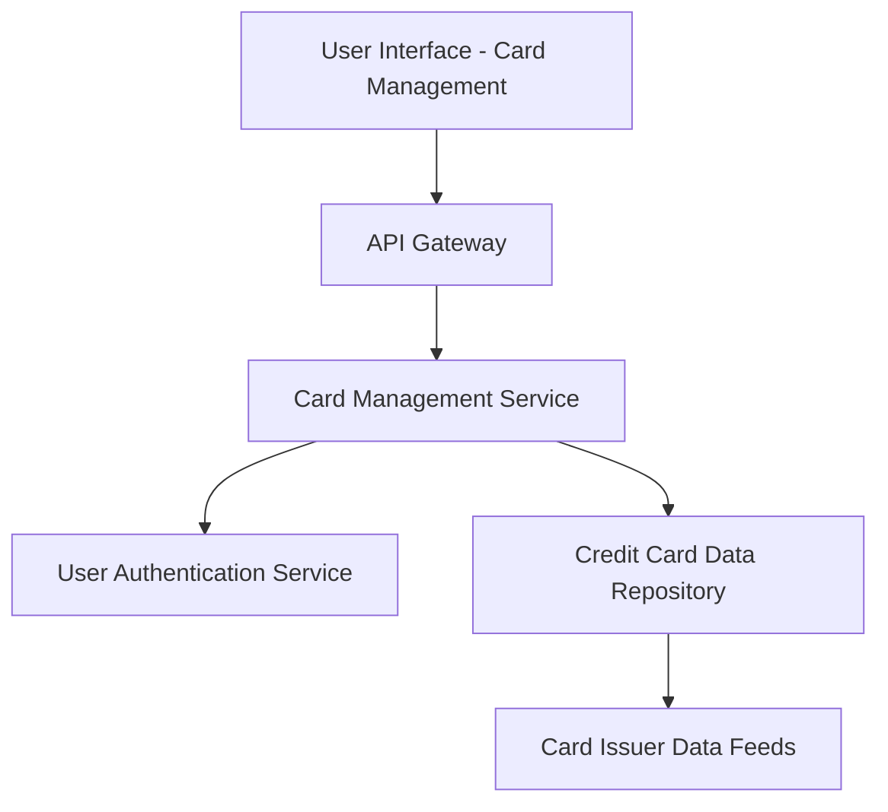

#### 1. High-Level Design

- **Summary:** This epic enables users to manage and view multiple credit cards within a single application interface. Users can view all their credit cards with relevant details, switch between cards seamlessly, and access card-specific information, providing a unified experience that eliminates the need for multiple banking portals.

- **Component Flow:**

- **Integration Points:** 
  - **Upstream:** User authentication service (for secure access), Credit card data repository (for storing card details), Card issuer data feeds (for card information)
  - **Downstream:** Card management UI for displaying and switching between cards

- **Key Assumptions:** 
  - Card data is synchronized periodically from card issuer data feeds
  - User authentication service provides session-based authorization for accessing card details

- **NFR Highlights:** System must support minimum 10 credit cards per user; card switching response time under 500ms; secure storage and display of card information

- **Data Flow:** User logs in via authentication service → User requests card list → Card Management Service retrieves all cards from Credit Card Data Repository → Cards displayed in UI → User selects specific card → Service fetches card-specific details → Card details and card-wise spend analysis rendered in UI with sub-500ms response time

#### 2. Validation Report

- **Requirements Coverage:** The design comprehensively covers all scope elements including multiple credit card display, card listing interface, card selection and switching, individual card details view, card-wise spend analysis, and credit card portfolio overview. NFRs for supporting minimum 10 cards per user, sub-500ms card switching, and secure storage are addressed through the architecture. All integration dependencies (authentication service, card data repository, card issuer feeds) are incorporated.