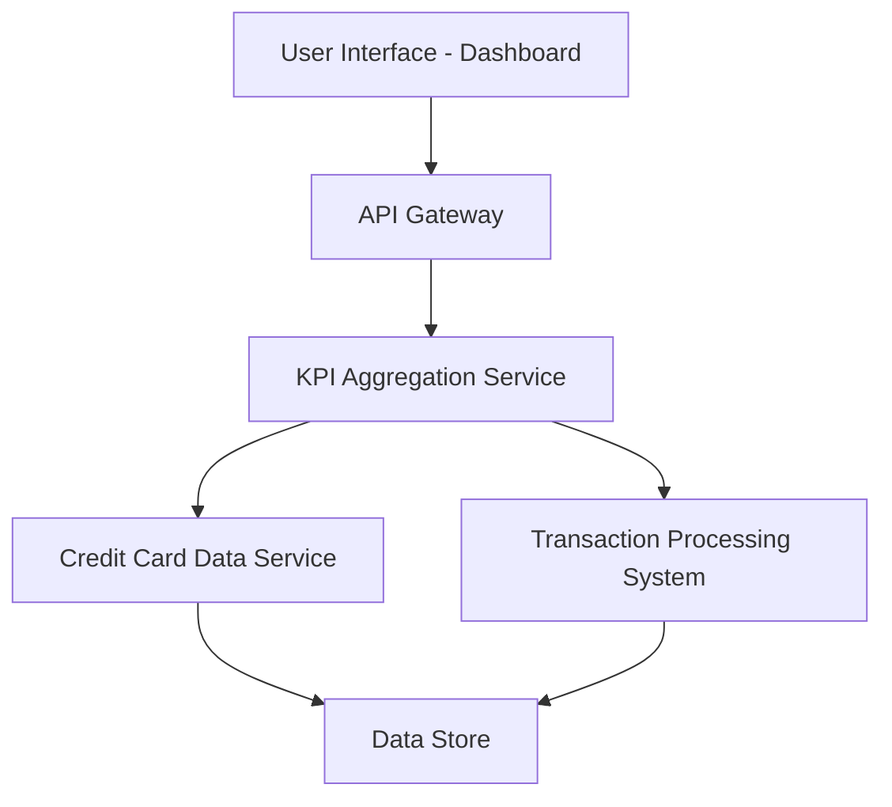

#### 1. High-Level Design

- **Summary:** This epic delivers a consolidated dashboard that displays key performance indicators (KPIs) for users' credit card portfolios. The dashboard provides real-time visibility into monthly spend, total credit limit, available credit, and outstanding amounts across all credit cards, enabling users to monitor their financial health and make informed decisions.

- **Component Flow:**

- **Integration Points:** 
  - **Upstream:** Credit card data service (for card details and balances), Transaction processing system (for monthly spend and outstanding amounts)
  - **Downstream:** Dashboard UI for rendering KPIs

- **Key Assumptions:** 
  - KPI data is refreshed in near real-time (within acceptable latency thresholds)
  - Credit card data service provides standardized API responses for card balances and limits

- **NFR Highlights:** Dashboard must load within 2 seconds; responsive design across desktop, tablet, and mobile devices; real-time data refresh for KPI metrics

- **Data Flow:** User requests dashboard → API Gateway routes to KPI Aggregation Service → Service fetches card details from Credit Card Data Service and transaction data from Transaction Processing System → Aggregated KPIs (monthly spend, credit limit, available credit, outstanding amounts) are calculated → Results returned to UI for display in consolidated view

#### 2. Validation Report

- **Requirements Coverage:** The design fully covers the epic's stated scope including dashboard KPI display, monthly spend tracking, total credit limit aggregation, available credit calculation, outstanding amount monitoring, responsive layout, and multi-card consolidated view. All NFRs (2-second load time, responsive design, real-time refresh) are addressed through the architecture. Integration dependencies with credit card data service and transaction processing system are incorporated.