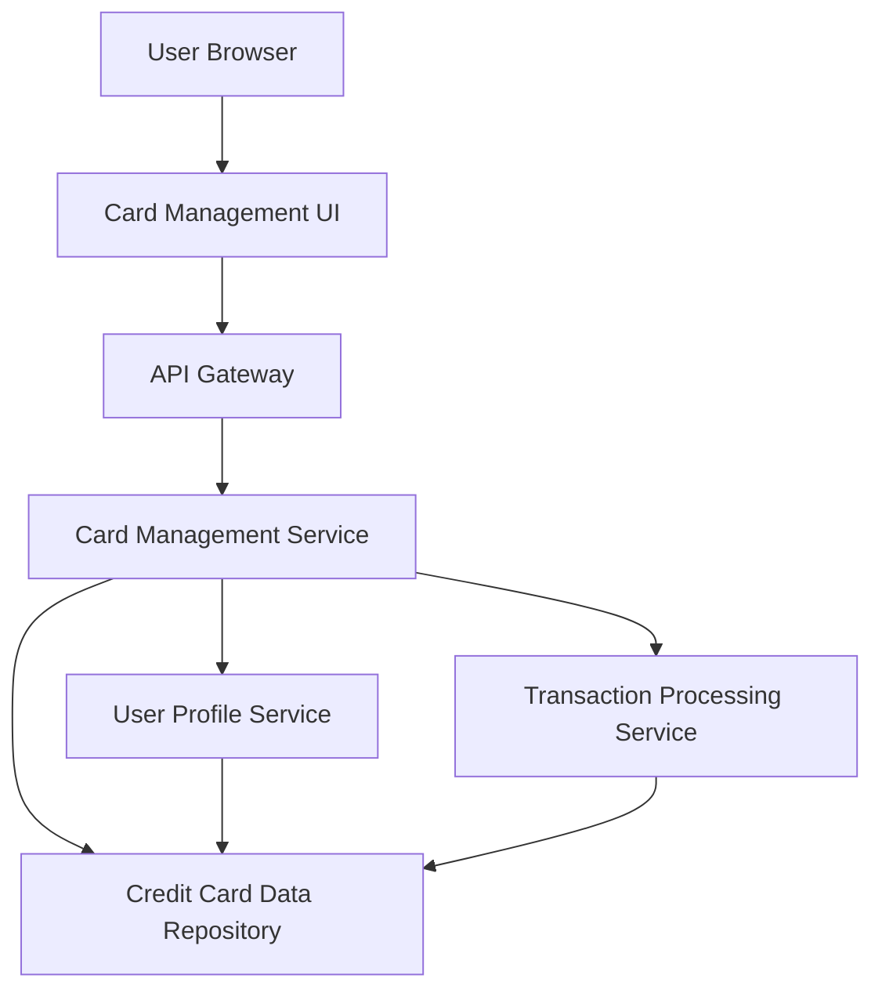

#### 1. High-Level Design

- **Summary**: This epic enables users to manage and monitor multiple credit cards within a unified platform. Users can register, view, and analyze multiple cards (minimum 10 per user), access card-specific details, track individual card balances and limits, compare performance across cards, and view transaction history for each card. The solution eliminates the need to access multiple bank portals by providing a single consolidated interface for multi-card management and card-wise spend analysis.

- **Component Flow**:

- **Integration Points**: 
  - **Upstream**: User Profile Service (for card registration and user-card associations)
  - **Upstream**: Transaction Processing Service (for card-specific transaction data and history)
  - **Data Repository**: Credit Card Data Repository (for storing card details, limits, balances, and metadata)

- **Key Assumptions**: 
  - Card registration requires manual entry of card details (card number, issuer, limit) or import capability; real bank integration is out of scope
  - Card comparison logic is based on spend analysis, utilization percentage, and transaction volume

- **NFR Highlights**: System must support minimum 10 credit cards per user; card data retrieval must complete within 3 seconds; data must be securely encrypted at rest and in transit; user session must timeout after 15 minutes of inactivity for security

- **Data Flow**: User registers/adds credit cards via Card Management UI → Card Management Service stores card details in User Profile Service and Credit Card Data Repository with encryption → User views all registered cards → Card Management Service retrieves card list from repository → For each card, service fetches balance, limit, and transaction data from Transaction Processing Service → Card-wise spend analysis is calculated and aggregated → Card Management UI displays comprehensive card information including limits, balances, transaction history, and comparison metrics → User can filter, sort, and compare cards based on spending patterns → All data transmission uses encryption; session timeout enforced at 15 minutes

#### 2. Validation Report

- **Requirements Coverage**: The design fully addresses the epic's scope including multiple credit card registration and display, card-wise spend analysis, individual card details view, card-specific balance tracking, card comparison capabilities, and transaction listing per card. All NFRs are incorporated: support for minimum 10 cards per user (database schema and UI design), 3-second card data retrieval (optimized queries and indexing), encryption at rest and in transit (TLS/SSL for transit, AES-256 for rest), and 15-minute session timeout (authentication service configuration). Integration dependencies with User Profile Service, Transaction Processing Service, and Credit Card Data Repository are clearly defined and mapped in the component architecture.