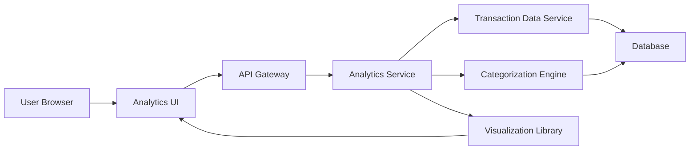

#### 1. High-Level Design

- **Summary**: This epic provides interactive data visualizations and analytical capabilities to help users understand spending behavior across predefined categories (Food & Dining, Fuel, Shopping, Travel, Entertainment, Utilities, Healthcare, Education, Miscellaneous). The system analyzes transactions, categorizes them automatically, and presents monthly spend trends through interactive charts and graphs, enabling users to identify patterns and seasonal variations over time.

- **Component Flow**:

- **Integration Points**: 
  - **Upstream**: Transaction Data Service (for raw transaction information)
  - **Internal**: Categorization Engine or ML Service (for automatic transaction classification into predefined categories)
  - **Frontend**: Visualization Library (for rendering interactive charts and graphs)
  - **Data Repository**: Database for storing transactions and categorization metadata

- **Key Assumptions**: 
  - Transaction categorization uses rule-based or ML-based engine; manual category override capability is assumed for user corrections
  - Historical data retention is 24 months as specified; older data may be archived or aggregated

- **NFR Highlights**: Analytics processing must complete within 5 seconds for up to 1000 transactions; visualizations must render within 2 seconds; support data aggregation for up to 24 months of historical data; charts must be responsive and interactive

- **Data Flow**: User selects time period and filters via Analytics UI → API Gateway routes request to Analytics Service → Analytics Service retrieves raw transactions from Transaction Data Service → Categorization Engine classifies transactions into predefined categories → Analytics Service aggregates data by category and time period → Processed data is formatted for visualization → Visualization Library renders interactive charts (category-wise spending, monthly trends) → User interacts with responsive, filterable visualizations showing spending patterns and insights

#### 2. Validation Report

- **Requirements Coverage**: The design comprehensively covers the epic's scope including category-wise spending visualization, monthly spend trend analysis, interactive charts and graphs, spending pattern identification, predefined category classification, transaction categorization engine, and time-period filtering. All NFRs are addressed: 5-second processing for 1000 transactions (through optimized queries and caching), 2-second visualization rendering (client-side rendering library), 24-month historical data support (database design), and responsive interactive charts (modern visualization library). Integration dependencies with Transaction Data Service, Categorization Engine, and Visualization Library are explicitly defined in the architecture.