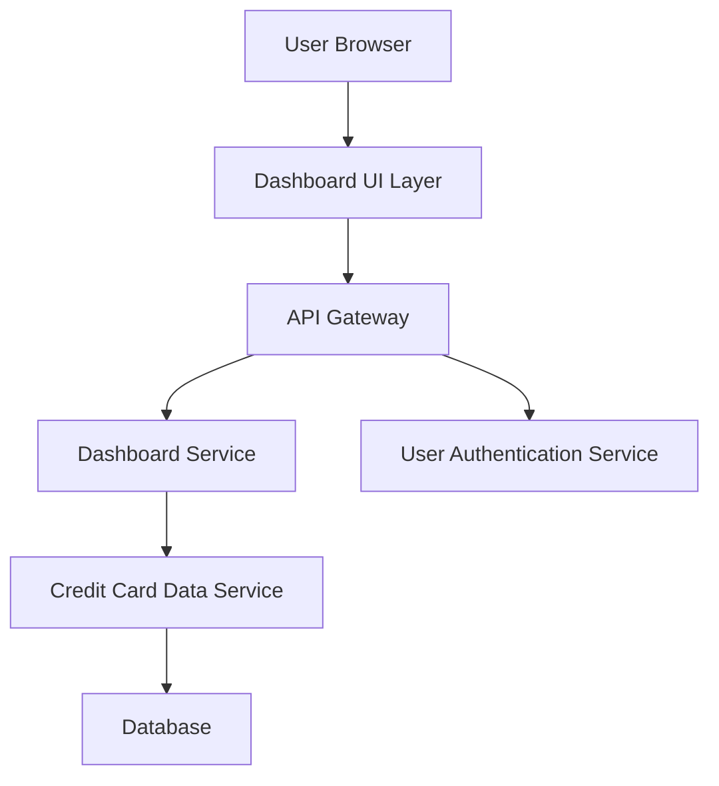

#### 1. High-Level Design

- **Summary**: This epic delivers a centralized dashboard displaying critical financial KPIs for credit card management. The dashboard aggregates data across all user credit cards to show monthly spend, total credit limit, available credit, and outstanding amounts in a consolidated, real-time interface. The solution enables users to quickly assess their overall credit card financial health through an at-a-glance view.

- **Component Flow**:

- **Integration Points**: 
  - **Upstream**: User Authentication Service (for secure access and session management)
  - **Downstream**: Credit Card Data Service (for fetching card details, transaction data, and balance information)
  - **Data Repository**: Database for storing aggregated metrics and card information

- **Key Assumptions**: 
  - Data refresh frequency is assumed to be near real-time (polling every 30-60 seconds or event-driven updates)
  - KPI calculations (available credit, outstanding amounts) are performed server-side with cached results for performance

- **NFR Highlights**: Dashboard must load within 2 seconds; support real-time data refresh; responsive design for desktop, tablet, and mobile; handle concurrent users simultaneously

- **Data Flow**: User authenticates via Authentication Service → Dashboard UI requests KPI data through API Gateway → Dashboard Service aggregates data from Credit Card Data Service → Credit Card Data Service queries Database for all user cards → Aggregated metrics (monthly spend, total limit, available credit, outstanding) are calculated and returned → Dashboard UI renders consolidated KPIs in responsive layout with real-time refresh capability

#### 2. Validation Report

- **Requirements Coverage**: The design fully covers the epic's stated scope including monthly spend display, total credit limit calculation, available credit computation, outstanding amount tracking, consolidated view across all cards, and responsive dashboard layout. All NFRs (2-second load time, real-time refresh, responsive design, concurrent user support) are addressed through appropriate architectural patterns (caching, API Gateway, responsive UI framework). Integration dependencies with Credit Card Data Service and User Authentication Service are explicitly mapped in the component flow.