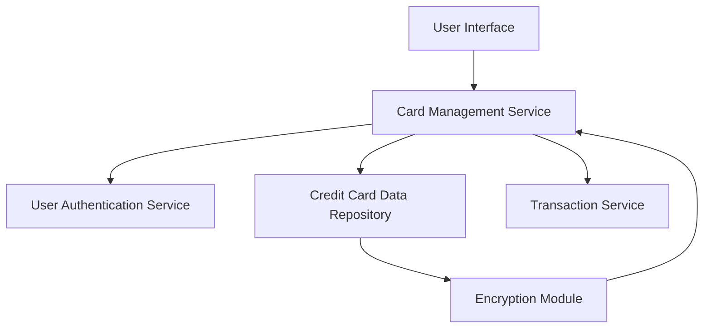

#### 1. High-Level Design

- **Summary:** This epic enables users to manage and monitor multiple credit cards (minimum 10 per user) from a unified interface, providing comprehensive visibility into each card's utilization, limits, spending patterns, and balances. Users can view all cards in one place, access card-specific details, perform card-wise spend analysis, and apply filtering and selection to optimize card usage decisions. The system ensures secure storage and display of card information with encryption.

- **Component Flow:**

- **Integration Points:**
  - **Upstream:** Credit card data repository (for storing and retrieving card information), User authentication service (for secure card access), Transaction service (for card-wise spending data)
  - **Downstream:** User Interface (for card display, filtering, and selection), Encryption Module (for secure card data handling)

- **Key Assumptions:** 
  - Card information is stored with encryption at rest; encryption/decryption is handled transparently by the Encryption Module without impacting the 1-second retrieval SLA.
  - Card utilization is calculated as (current balance / credit limit) * 100; no complex utilization algorithms are required.

- **NFR Highlights:** System must support minimum 10 credit cards per user, card data retrieval must complete within 1 second, ensure secure storage and display with encryption, support concurrent access for multiple users.

- **Data Flow:** User logs in via User Authentication Service → User Interface requests card list from Card Management Service → Card Management Service retrieves encrypted card data from Credit Card Data Repository → Encryption Module decrypts card information → Card Management Service fetches card-wise spending data from Transaction Service → Consolidated card details (limits, balances, utilization, spending) are aggregated → Data is sent to User Interface for display → User can filter, select, and view individual card details with real-time updates.

#### 2. Validation Report

- **Requirements Coverage:** The design comprehensively covers all scope elements including multiple credit card display, card-wise spend analysis, individual card details view, card selection and filtering, card utilization tracking, and per-card credit limit and balance display. All NFRs are addressed: support for minimum 10 cards per user is a configuration parameter, 1-second card data retrieval is achievable through optimized database queries and caching, secure storage and display with encryption is handled by the Encryption Module, and concurrent access is supported through standard multi-user architecture patterns. Integration dependencies with credit card data repository, user authentication service, and transaction service are properly mapped and secured.