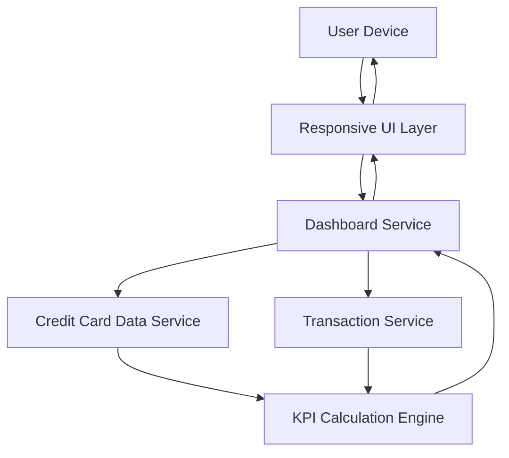

#### 1. High-Level Design

- **Summary:** This epic delivers a consolidated, responsive dashboard providing real-time visibility into credit card portfolio KPIs including monthly spend, total credit limit, available credit, and outstanding amounts across all cards. The dashboard serves as the primary interface for monitoring overall financial health and credit utilization from desktop, tablet, and mobile devices.

- **Component Flow:**

- **Integration Points:**
  - **Upstream:** Credit Card Data Service (for retrieving card balances, limits, and outstanding amounts)
  - **Upstream:** Transaction Service (for calculating monthly spend and transaction aggregations)
  - **Downstream:** Responsive UI Layer (for multi-device rendering)

- **Key Assumptions:**
  - Real-time data refresh is achieved through periodic polling or event-driven updates from backend services
  - KPI calculations (available credit, credit utilization) are performed server-side to ensure consistency across devices

- **NFR Highlights:** Dashboard must be responsive across desktop, tablet, and mobile devices; page load time must support real-time data refresh; UI must support multiple concurrent users with acceptable performance.

- **Data Flow:** User accesses dashboard → Responsive UI Layer sends request to Dashboard Service → Dashboard Service queries Credit Card Data Service for card balances, limits, and outstanding amounts → Dashboard Service queries Transaction Service for monthly spend data → KPI Calculation Engine aggregates data (total credit limit, available credit, credit utilization) → Consolidated KPIs returned to Dashboard Service → Dashboard Service formats data for Responsive UI Layer → Multi-device optimized dashboard rendered on User Device with real-time refresh capability.

#### 2. Validation Report

- **Requirements Coverage:** The design fully satisfies the epic scope including monthly spend display, total credit limit aggregation, available credit calculation, outstanding amount tracking, responsive dashboard layout, and multi-card consolidated view. All NFRs are explicitly addressed: responsive design across devices through dedicated Responsive UI Layer, real-time data refresh via Dashboard Service architecture, and multi-user support through scalable service design. Dependencies on credit card data service and transaction service are clearly mapped with dedicated integration points. The KPI Calculation Engine ensures accurate financial metric computation for informed decision-making.