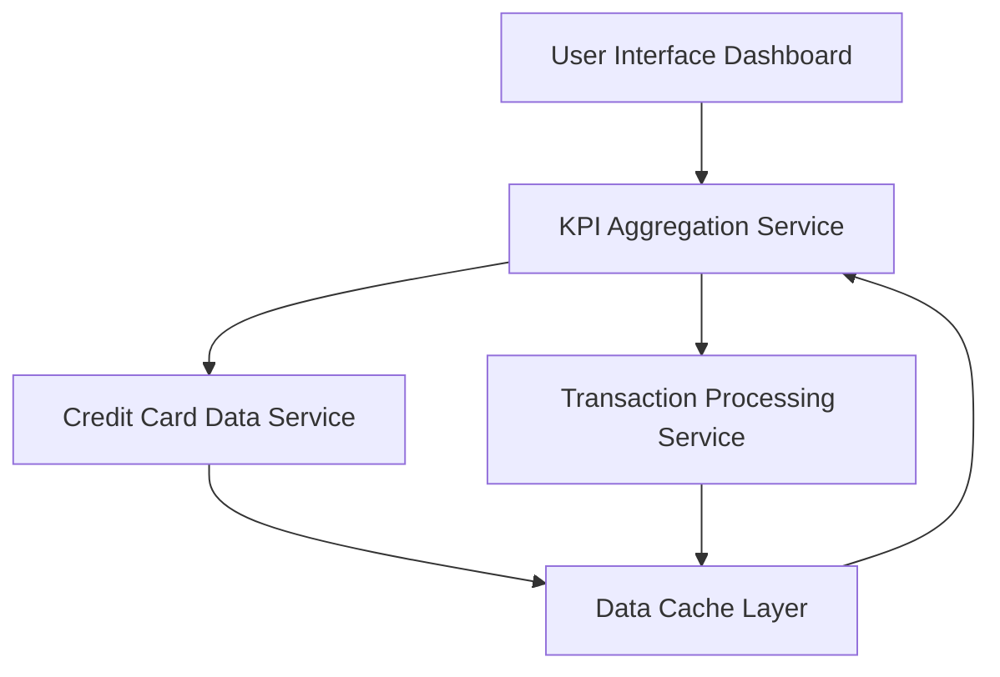

#### 1. High-Level Design

- **Summary:** This epic develops a centralized dashboard that serves as the primary landing interface, displaying key performance indicators (KPIs) for credit card management including monthly spend, total credit limit, available credit, and outstanding amounts. The dashboard provides a consolidated snapshot of the user's credit card portfolio and financial status, enabling quick decision-making through real-time data refresh and responsive design across devices.

- **Component Flow:**

- **Integration Points:**
  - **Upstream:** Credit card data service (for retrieving card balances and limits), Transaction processing service (for calculating monthly spend and outstanding amounts)
  - **Downstream:** User Interface Dashboard (responsive layout for desktop and mobile), Data Cache Layer (for real-time data refresh)

- **Key Assumptions:** 
  - Credit card balances and limits are updated in near real-time by the credit card data service; batch updates are acceptable within the 2-second load time constraint.
  - Monthly spend is calculated based on the current calendar month; fiscal month calculations are not required.

- **NFR Highlights:** Dashboard must load within 2 seconds, support responsive design across desktop and mobile devices, handle real-time data refresh for KPI updates, maintain 99.9% uptime.

- **Data Flow:** User accesses the dashboard → KPI Aggregation Service requests data from Credit Card Data Service (card balances, limits) and Transaction Processing Service (monthly spend, outstanding amounts) → Data is retrieved from Data Cache Layer if available, otherwise fetched from source systems → KPI Aggregation Service consolidates metrics (total credit limit, available credit, monthly spend, outstanding amounts) → Aggregated KPIs are formatted and sent to User Interface Dashboard → Dashboard renders responsive layout with real-time KPI visualization across devices.

#### 2. Validation Report

- **Requirements Coverage:** The design fully addresses the epic's scope including monthly spend display, total credit limit calculation, available credit tracking, outstanding amount monitoring, responsive dashboard layout, and consolidated KPI visualization. All NFRs are covered: 2-second load time is supported through data caching, responsive design is addressed in the UI layer, real-time data refresh is enabled via the KPI Aggregation Service and Data Cache Layer, and 99.9% uptime is achievable through standard high-availability architecture patterns. Integration dependencies with credit card data service and transaction processing service are properly mapped to system components.