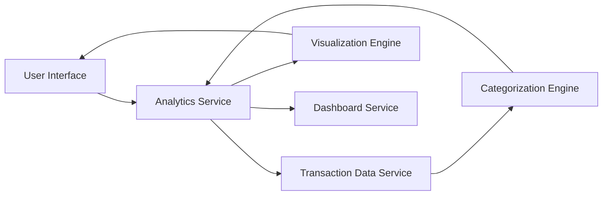

#### 1. High-Level Design

- **Summary:** This epic provides comprehensive transaction analytics with interactive visualizations for spending patterns across nine predefined categories (Food & Dining, Fuel, Shopping, Travel, Entertainment, Utilities, Healthcare, Education, Miscellaneous). Users can analyze category-wise spending breakdowns, view monthly spend trends, and gain actionable insights into financial behavior through interactive charts and graphs.

- **Component Flow:**

- **Integration Points:**
  - **Upstream:** Transaction Data Service (for raw transaction records and historical data)
  - **Upstream:** Categorization Engine (for transaction classification into nine predefined categories)
  - **Downstream:** Dashboard Service (for consolidated views and KPI integration)
  - **Downstream:** Visualization Engine (for rendering interactive charts and graphs)

- **Key Assumptions:**
  - Transactions are automatically categorized by the categorization engine using predefined rules or ML models
  - Historical transaction data is retained for at least 12 months to support meaningful trend analysis

- **NFR Highlights:** Analytics must process and display transaction data with minimal latency; visualizations must be interactive and responsive; system must handle historical transaction data efficiently for trend analysis.

- **Data Flow:** User requests analytics view → Analytics Service retrieves raw transactions from Transaction Data Service → Transactions are processed through Categorization Engine to assign categories → Analytics Service aggregates data by category and time period → Visualization Engine generates interactive charts (category breakdown, monthly trends) → Results rendered in User Interface and optionally pushed to Dashboard Service for consolidated display.

#### 2. Validation Report

- **Requirements Coverage:** The design comprehensively addresses all scope elements including category-wise spending visualization, monthly spend trends, interactive charts/graphs, transaction categorization, and spending pattern analysis across nine predefined categories. The architecture explicitly handles the NFRs for minimal latency through dedicated Analytics Service, interactive/responsive visualizations via Visualization Engine, and historical data handling through Transaction Data Service. Integration dependencies with transaction data service, categorization engine, and dashboard service are clearly defined and mapped in the component flow.