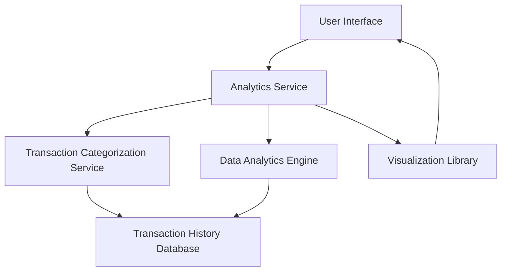

#### 1. High-Level Design

- **Summary:** This epic delivers interactive analytics and visualization capabilities that enable users to understand their spending patterns across nine predefined categories (Food & Dining, Fuel, Shopping, Travel, Entertainment, Utilities, Healthcare, Education, Miscellaneous) and analyze monthly spend trends over time. The system aggregates historical transaction data, categorizes expenses, and presents insights through interactive charts and graphs to support data-driven financial decision-making.

- **Component Flow:**

- **Integration Points:**
  - **Upstream:** Transaction categorization service (for expense classification), Transaction history database (for historical transaction data)
  - **Downstream:** Visualization library (for rendering charts and graphs), Data analytics engine (for trend calculation and aggregation)

- **Key Assumptions:** 
  - Transactions are automatically categorized by the transaction categorization service with sufficient accuracy; manual recategorization is not in scope.
  - Monthly spend trends are calculated based on transaction date, assuming all transactions are timestamped correctly.

- **NFR Highlights:** Analytics visualizations must render within 3 seconds, support interactive filtering and drill-down, handle minimum 12 months of historical data, ensure 100% data aggregation accuracy.

- **Data Flow:** User requests spending analytics from the UI → Analytics Service retrieves transaction data from Transaction History Database → Transaction Categorization Service classifies expenses into nine categories → Data Analytics Engine aggregates data by category and calculates monthly trends → Results are formatted and passed to Visualization Library → Interactive charts and graphs are rendered in the User Interface for exploration and drill-down.

#### 2. Validation Report

- **Requirements Coverage:** The design comprehensively covers the epic's stated scope including category-wise spending visualization across nine categories, monthly spend trend analysis, interactive charts and graphs, historical spending comparison, and spending pattern identification. All NFRs related to rendering performance (3 seconds), interactive capabilities, historical data handling (12 months minimum), and data accuracy (100%) are addressed through appropriate service architecture and database design. The integration dependencies with transaction categorization service, data analytics engine, visualization library, and transaction history database are clearly mapped to system components.